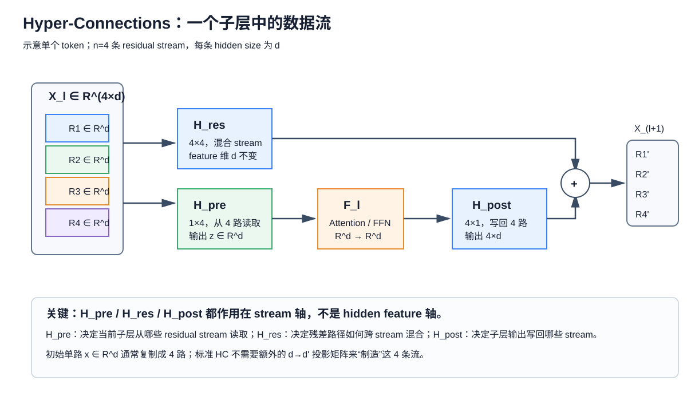
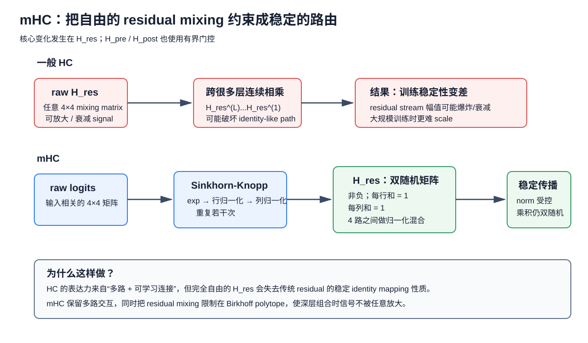
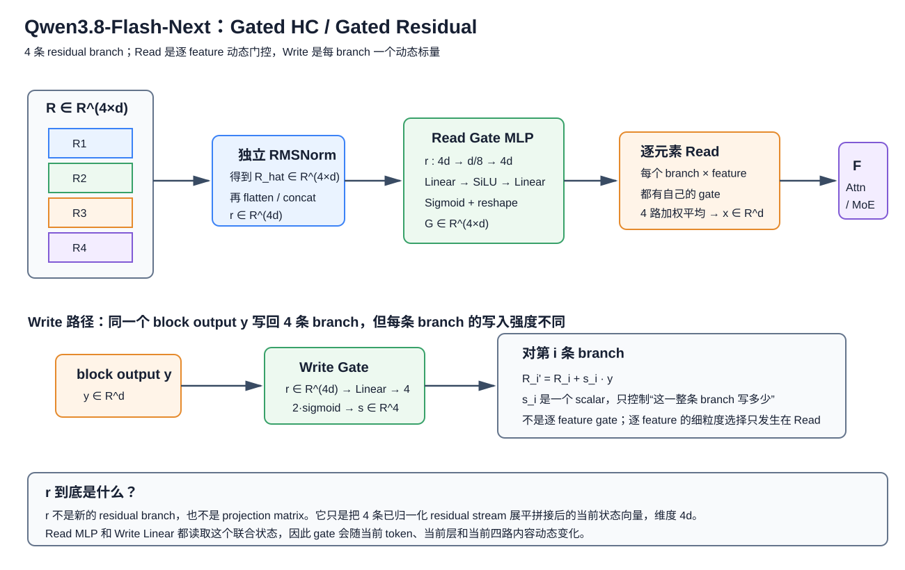
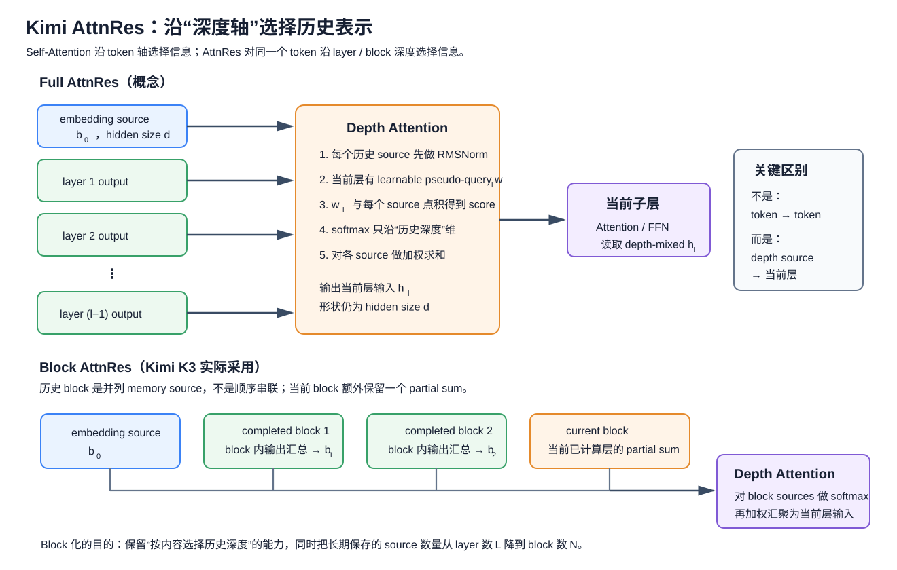

# 残差连接

[[main|返回知识主干]] · [[预训练]] · [[注意力机制]]

围绕现代 LLM 中 residual stream 的信息传播、Hyper-Connections、mHC、Qwen Gated Residual 与 Kimi AttnRes 整理。

## 问题目录

- [[残差连接#为什么现代 LLM 要在传统残差连接上做创新？有哪些主要方向？|为什么现代 LLM 要在传统残差连接上做创新？有哪些主要方向？]]
- [[残差连接#Hyper-Connections 是什么？数据在其中怎样流动？|Hyper-Connections 是什么？数据在其中怎样流动？]]
- [[残差连接#相比一般 HC，DeepSeek 的 mHC 有什么创新？为什么这样做？|相比一般 HC，DeepSeek 的 mHC 有什么创新？为什么这样做？]]
- [[残差连接#Qwen3.8-Flash-Next 的 Gated HC 与一般 HC 有什么区别？|Qwen3.8-Flash-Next 的 Gated HC 与一般 HC 有什么区别？]]
- [[残差连接#Kimi 的 AttnRes 在残差连接上做了什么创新？|Kimi 的 AttnRes 在残差连接上做了什么创新？]]

---

## 为什么现代 LLM 要在传统残差连接上做创新？有哪些主要方向？

传统 Pre-Norm Transformer 的 residual stream 本质上是一个**单一路径、固定加法**的信息通道。它非常利于深层网络训练，但模型不断加深后也暴露出两个限制：

1. **所有历史层都被压进同一个 residual state**：早期信息会不断与新信息混合，单个层的贡献容易被深层累加稀释。
2. **跨层连接方式固定**：每一层默认“读当前 residual、写回同一个 residual”，模型无法显式选择应该从哪些历史路径读取、又应向哪些路径写入。

现代改进主要沿几条路线发展：

| 方向 | 核心思想 | 代表 |
|---|---|---|
| 残差缩放 / 门控 | 控制每层写入 residual 的强度 | residual scaling、gated residual 等 |
| 多 residual stream | 把单一路径扩展成多条并行信息流 | Hyper-Connections（HC） |
| 对多流混合加稳定约束 | 保留 HC 表达力，同时恢复稳定的 identity-like propagation | DeepSeek mHC |
| 动态细粒度读写 | 多流继续保留，但按当前内容动态决定怎么读、怎么写 | Qwen3.8 Gated Residual |
| 沿深度做注意力 | 不再固定累加全部历史，而是直接选择历史层表示 | Kimi Attention Residuals |

这些方法解决的是 **depth / residual information flow**，与 Attention 解决的 token 间信息交互不是同一个维度的问题。

参考：[Hyper-Connections](https://arxiv.org/abs/2409.19606) · [mHC](https://arxiv.org/abs/2512.24880) · [Attention Residuals](https://arxiv.org/abs/2603.15031)

---

## Hyper-Connections 是什么？数据在其中怎样流动？

**Hyper-Connections（HC）** 将传统的一条 residual stream 扩展为多条并行 stream。以 4 路为例，一个 token 的 residual state 不再是单个 $d$ 维向量，而是 4 个 $d$ 维向量组成的状态 $X_l\in\mathbb{R}^{4\times d}$。

一个子层周围有三类连接：

- **$H_{\mathrm{pre}}$（Read）**：从 4 条 stream 中组合出一个 $d$ 维输入，送入 Attention / FFN。
- **$H_{\mathrm{post}}$（Write）**：把子层产生的一个 $d$ 维输出重新分发到 4 条 stream。
- **$H_{\mathrm{res}}$（Residual Mixing）**：不经过子层，直接在 4 条 residual stream 之间混合信息。

关键是：**这些映射主要作用于 stream 轴，而不是 hidden feature 轴。** $d$ 仍然是每条 residual stream 的 hidden size。标准 HC 也不需要额外用一个所谓 $C$ 矩阵把 hidden state 投影成 4 路；初始单路表示可以直接复制为多条 residual stream。

HC 的价值在于，网络不再只能依赖一条固定 residual path，而能学习不同深度之间更丰富的读写与跨流连接。

参考：[Hyper-Connections](https://arxiv.org/abs/2409.19606)

---

## 相比一般 HC，DeepSeek 的 mHC 有什么创新？为什么这样做？

一般 HC 的 $H_{\mathrm{res}}$ 可以是自由学习的 mixing matrix。表达力很强，但多层连续相乘后可能任意放大或衰减 residual signal，破坏传统残差连接赖以稳定深层训练的 **identity mapping** 性质。

DeepSeek 的 **Manifold-Constrained Hyper-Connections（mHC）** 核心不是增加更多路径，而是**约束这些路径怎样混合**。

mHC 将 $H_{\mathrm{res}}$ 投影为 **doubly stochastic matrix（双随机矩阵）**：

- 所有元素非负；
- 每一行之和为 1；
- 每一列之和为 1。

实际通过 **Sinkhorn-Knopp** 的交替行/列归一化实现。这样每次 residual mixing 更接近“归一化地重新分配 4 条 stream 的信息”，而不是允许任意增益。

这样做有三个直接目的：

- **控制信号与梯度尺度**：双随机矩阵的谱范数受控；
- **深层组合仍稳定**：双随机矩阵相乘后仍是双随机矩阵；
- **保留 HC 的多流表达力**：仍允许 stream 之间动态交换信息，而不是退回单路 residual。

mHC 还对 $H_{\mathrm{pre}}$、$H_{\mathrm{post}}$ 使用有界门控，使读写映射也更稳定。它解决的核心问题可以概括为：**HC 扩大了 residual connectivity，但自由 connectivity 不容易规模化；mHC 用几何约束换取可扩展的训练稳定性。**

参考：[mHC: Manifold-Constrained Hyper-Connections](https://arxiv.org/abs/2512.24880)

---

## Qwen3.8-Flash-Next 的 Gated HC 与一般 HC 有什么区别？

Qwen3.8-Flash-Next 的 **Gated Residual（GR）** 仍然把 residual stream 扩展为 4 条，但它没有一般 HC 的显式 $H_{\mathrm{res}}$ 跨流 mixing matrix，而是把主要表达能力放到**动态 Read** 上，并采用更简单的 **scalar Write**。

### Read：逐 branch、逐 feature 动态读取

设 4 条 residual branch 为 $R_1,\ldots,R_4$，每条维度都是 $d$。首先每条 branch 独立做 RMSNorm，再把 4 条归一化结果展平拼接：

- $\hat R$ 的形状：$4\times d$
- $r=\operatorname{vec}(\hat R)$：形状 $4d$

这里的 **$r$ 只是四条当前 residual state 的联合表示**。它不是新的 residual stream，也不是投影矩阵。

Read gate 网络读取 $r$，经过一个低秩 bottleneck MLP：

`4d → d/8 → 4d → sigmoid`

再 reshape 成 $4\times d$ 的 gate。于是**每条 branch 的每个 hidden feature 都有自己的读取权重**。四条 gated branch 再平均成普通 $d$ 维输入，送入 Attention / GDN / MoE。

因此所谓“某个 feature 更读 $R_1$”指的是：对当前 token、当前层的某一个 hidden channel，四条 branch 在这个 channel 上各有一个动态 gate；模型可以让该 channel 的输入更多来自其中某几条 branch，而不是整条 branch 被统一选择。

### Write：每条 branch 一个动态标量

子层输出 $y\in\mathbb{R}^d$ 后，Write gate 同样读取联合状态 $r$，但这里只通过一个线性映射生成 4 个值，再经 $2\,\sigma(\cdot)$ 得到：

$$
s=[s_1,s_2,s_3,s_4]\in\mathbb{R}^4
$$

其中每个 $s_i$ **只是一个 scalar**。第 $i$ 条 residual branch 更新为：

$$
R_i'=R_i+s_i y
$$

因此 $s_i$ 的作用不是“决定第 $i$ 个 feature 怎么写”，而是**决定同一个 $d$ 维子层输出整体向第 $i$ 条 branch 注入多少**。$2\,\sigma(\cdot)$ 让写入系数位于 $(0,2)$；初始化附近可以保持接近普通 residual 的单位写入尺度。

和一般 HC 相比，可以压缩成：

| 一般 HC | Qwen GR |
|---|---|
| 有显式 $H_{\mathrm{res}}$ 做跨 stream mixing | residual branch 直接保留，不做显式 $H_{\mathrm{res}}$ 混合 |
| $H_{\mathrm{pre}}$ 决定如何从多流读取 | 使用 $4\times d$ 的逐元素动态 Read gate |
| $H_{\mathrm{post}}$ 将输出写回多流 | 每条 branch 只用一个 scalar $s_i$ 控制写入强度 |

参考：[Qwen3.8-Flash-Next](https://qwen.ai/blog?id=qwen3.8-flash-next) · [NVIDIA NeMo implementation](https://docs.nvidia.com/nemo/automodel/nemo-automodel/nemo_automodel/components/models/qwen3_8_flash_next/layers)

---

## Kimi 的 AttnRes 在残差连接上做了什么创新？

传统 residual connection 会把历史各层输出顺序累加进一个 state。**Attention Residuals（AttnRes）** 把这个问题重新表述成“沿网络深度做检索”：当前层不是默认等权接收所有历史，而是通过 attention 选择更相关的历史表示。

Full AttnRes 中，每个历史层输出（以及 embedding）都是一个 depth source。当前层拥有一个可学习的 **pseudo-query $w_l$**；对于同一个 token，历史各层表示经过 RMSNorm 后与 $w_l$ 计算分数，再沿**深度维**做 softmax，最后得到加权和 $h_l\in\mathbb{R}^d$ 作为当前层输入。

这与普通 Self-Attention 的区别是：

- Self-Attention：同一层内，沿 **sequence / token 轴**选择信息；
- AttnRes：同一个 token，沿 **layer / depth 轴**选择历史表示。

Full AttnRes 如果保存每一层输出，会增加 activation memory 和 pipeline communication。Kimi K3 因此采用 **Block AttnRes**：把若干连续层组成一个 block，block 内部输出累加成一个 block representation；跨 block 时只对这些 block-level representation 做 depth attention。当前 block 还保留一个 partial sum $b_n^{(i-1)}$，供 block 内后续层读取。

因此它在保留“按内容选择历史深度”的能力时，把需要长期保存的 source 数量从层数 $L$ 降到 block 数 $N$。Kimi K3 使用约 12 层一组的 block 设计。

> AttnRes 与 HC 不是同一种多流结构：HC 在**宽度方向**维护多条并行 residual stream；AttnRes 在**深度方向**把历史 layer/block representation 变成可注意力检索的 memory。

参考：[Attention Residuals](https://arxiv.org/abs/2603.15031) · [Kimi K3](https://www.kimi.ai/blog/kimi-k3)
