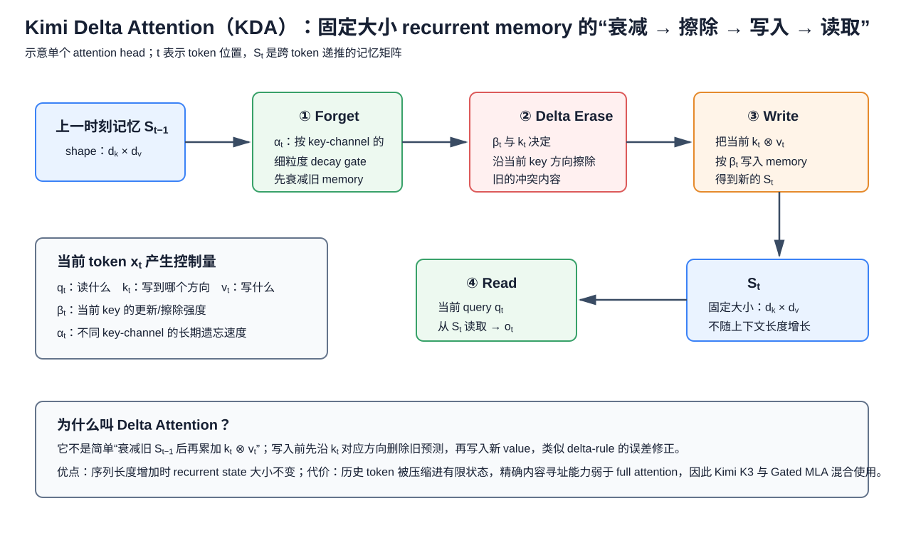

# 注意力机制

[[main|返回知识主干]] · [[预训练]] · [[残差连接]]

围绕现代 LLM 中 Attention / Linear Attention 的核心机制与演进整理。已有 MHA、GQA、MLA 细节暂保留在 [[预训练]]；本页先记录 Kimi Delta Attention（KDA）。

## 问题目录

- [[注意力机制#KDA 是什么？|KDA 是什么？]]

---

## KDA 是什么？

**Kimi Delta Attention（KDA）** 是一种带细粒度遗忘门的 **linear / recurrent attention**。它不为每个历史 token 保存完整 KV Cache，而是把历史信息递推压缩到固定大小的状态矩阵 $S_t$ 中。

对单个 Attention Head，可以把 KDA 的一次 token 更新理解成四步：

1. **Forget**：先用 $\alpha_t$ 对旧状态 $S_{t-1}$ 的不同 key channel 做细粒度衰减，决定哪些长期记忆继续保留。
2. **Delta Erase**：根据当前 $k_t$ 与更新强度 $\beta_t$，沿当前 key 对应的方向擦除旧内容，避免新旧 value 在同一地址上不断叠加。
3. **Write**：把当前 $k_t$ 与 $v_t$ 形成的 rank-1 信息写入状态，得到新的 $S_t$。
4. **Read**：当前 query $q_t$ 从 $S_t$ 中读取结果，形成该 token 的输出 $o_t$。

其中：

- $q_t$：当前 token 想读取什么；
- $k_t$：当前信息写入 memory 的“地址方向”；
- $v_t$：真正要保存的内容；
- $\beta_t$：当前地址的擦除 / 写入强度；
- $\alpha_t$：不同 key channel 的遗忘速度，是 KDA 相比更粗粒度 gated delta rule 的重要改进。

之所以叫 **Delta Attention**，关键就在“写之前先做定向误差修正”：它不是简单地做

$$
S_t=\operatorname{decay}(S_{t-1})+k_t v_t^\top
$$

而是先沿 $k_t$ 对应方向删除旧预测，再写入新的 value，更接近 delta-rule 的更新方式。

### 为什么使用 KDA？

标准 Full Attention 的 KV Cache 会随上下文长度增加；KDA 的 recurrent state 大小固定，因此长序列推理的状态成本不随 token 数线性增长，序列计算也可以实现为 linear attention。

代价是：**所有历史 token 都被压缩进有限状态，无法像 Full Attention 那样随时精确回到任意历史 token 做内容寻址。** 因此 Kimi K3 并没有只使用 KDA，而是采用 Hybrid Attention：大多数层使用 KDA，并周期性插入 Gated MLA 进行显式全局检索。

Kimi K3 的 backbone 采用约 `3 × KDA + 1 × Gated MLA` 的重复模式，最后再以 Gated MLA 收尾。

> KDA 解决的是 **sequence 维的信息压缩与长上下文效率**；[[残差连接#Kimi 的 AttnRes 在残差连接上做了什么创新？|AttnRes]] 解决的是 **depth 维的跨层信息流**。二者是 Kimi K3 中两条不同的架构创新线。

参考：[Kimi Linear Technical Report](https://yzhang.site/assets/pubs/techreport/2025/kda.pdf) · [Kimi K3](https://www.kimi.ai/blog/kimi-k3)
