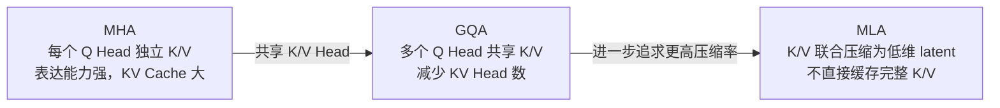
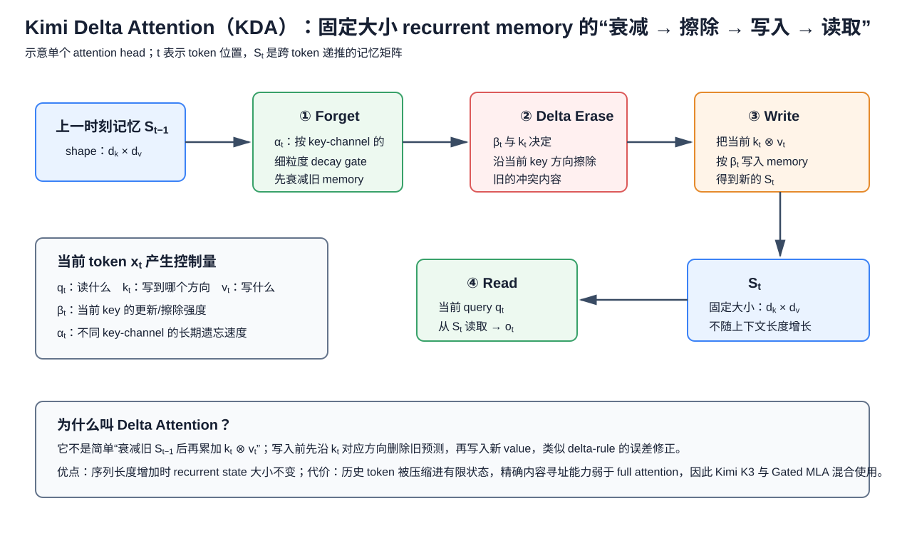

# 注意力机制

[[预训练|返回上级：预训练]] · [[main|返回知识主干]] · [[残差连接]]

围绕现代 LLM 中 Attention / Linear Attention 的核心机制与演进整理。MHA、GQA、MLA 与 KDA 等注意力结构统一归档在这里。

## 问题目录

- [[注意力机制#MHA 的基本原理是什么？|MHA 的基本原理是什么？]]
- [[注意力机制#GQA 如何在 MHA 上降低 KV Cache？|GQA 如何在 MHA 上降低 KV Cache？]]
- [[注意力机制#MLA 的基本原理是什么？|MLA 的基本原理是什么？]]
- [[注意力机制#为什么注意力结构会从 MHA 发展到 GQA，再到 MLA？|为什么注意力结构会从 MHA 发展到 GQA，再到 MLA？]]
- [[注意力机制#MLA 中的低秩降维是怎么做的？降维之后又是怎么恢复的？|MLA 中的低秩降维是怎么做的？降维之后又是怎么恢复的？]]
- [[注意力机制#为什么 MLA 里的 RoPE 要换成 Decoupled RoPE？|为什么 MLA 里的 RoPE 要换成 Decoupled RoPE？]]
- [[注意力机制#KDA 是什么？|KDA 是什么？]]

---

## MHA 的基本原理是什么？

**Multi-Head Attention（MHA）** 先将 Hidden State 分别线性投影为 Query、Key、Value：

$$Q=XW^Q,\qquad K=XW^K,\qquad V=XW^V$$

单个 Head 的注意力为：

$$\operatorname{Attention}(Q,K,V)=\operatorname{softmax}\left(\frac{QK^T}{\sqrt{d_h}}+M\right)V$$

其中 Query 表示当前 Token 要匹配的信息，Key 用于与 Query 计算相关性，Value 是被注意力权重聚合的内容。MHA 使用多个独立 Head，每个 Head 拥有自己的 $Q/K/V$ 投影，最后将各 Head 输出拼接并再次投影。

在自回归推理中，历史 Token 的 K/V 不会改变，因此会保存为 **KV Cache**。若有 $H$ 个 Head，每个 Head 维度为 $d_h$，则每层每个 Token 需要缓存约：

$$2Hd_h$$

个 K/V 元素。长上下文、大 Batch 和多层模型下，KV Cache 会成为显存容量与显存带宽的重要瓶颈。

参考：[Attention Is All You Need](https://arxiv.org/abs/1706.03762)

---

## GQA 如何在 MHA 上降低 KV Cache？

**Grouped-Query Attention（GQA）** 保留多个独立 Query Head，但让一组 Query Head **共享同一套 Key/Value Head**。

若 MHA 有 $H$ 个 Query Head，也有 $H$ 组 K/V；GQA 只保留 $G$ 组 K/V（$1<G<H$），则 KV Cache 从：

$$2Hd_h$$

降低为：

$$2Gd_h$$

因此缓存量约缩小为原来的 $G/H$。MHA 可以看作 $G=H$ 的特例，MQA 则是 $G=1$ 的极端情况。

GQA 的核心取舍是：**牺牲一部分 K/V Head 的独立表示能力，换取显著更小的 KV Cache 和更高的解码效率，同时尽量保持接近 MHA 的模型质量。**

参考：[GQA: Training Generalized Multi-Query Transformer Models from Multi-Head Checkpoints](https://arxiv.org/abs/2305.13245)

---

## MLA 的基本原理是什么？

**Multi-Head Latent Attention（MLA）** 不再主要通过“减少 K/V Head 数量”压缩缓存，而是将所有 Head 的 K/V 信息先联合压缩到一个低维 **latent vector**：

$$c_t^{KV}=W^{DKV}h_t$$

再通过不同的上投影得到各 Head 所需的内容 Key 和 Value：

$$k_t^C=W^{UK}c_t^{KV},\qquad v_t^C=W^{UV}c_t^{KV}$$

推理时主要缓存低维 $c_t^{KV}$，而不是每个 Head 的完整 K/V。借助矩阵乘法结合律，还可以进行 **weight absorption**，将上投影矩阵吸收到 Query / Output 投影中，使解码时不必真正恢复完整 K/V。

MLA 另外使用一条独立的 **Decoupled RoPE** 路径保存位置相关的 Key。因此实际缓存主要由低维 $c_t^{KV}$ 和较小的 RoPE Key 构成。

参考：[DeepSeek-V2 Technical Report](https://arxiv.org/abs/2405.04434)

---

## 为什么注意力结构会从 MHA 发展到 GQA，再到 MLA？

这更适合作为一条**问题驱动的理解路线**，而不是严格的历史替代关系：GQA 和 MLA 都是在缓解 MHA 的 KV Cache 与解码内存带宽瓶颈，只是压缩方式不同。

- **MHA**：每个 Query Head 都有独立 K/V，表达自由度高，但 KV Cache 随 Head 数增长。
- **GQA**：通过 Head Sharing 减少 K/V 数量，在质量和推理效率之间折中。
- **MLA**：进一步从“减少 K/V Head”转向“压缩 K/V 表示本身”，用低维 latent 保存多个 Head 共享的基础信息，再通过投影保持多头表达能力。

三者都仍采用标准的注意力匹配思想，也都没有从根本上消除 Full Attention 随序列长度增长的二次计算复杂度；这里主要优化的是 **KV Cache 宽度和自回归解码效率**。

参考：[GQA](https://arxiv.org/abs/2305.13245) · [DeepSeek-V2](https://arxiv.org/abs/2405.04434)

---

## MLA 中的低秩降维是怎么做的？降维之后又是怎么恢复的？

MLA 将原本直接从 Hidden State 生成完整多头 K/V 的大投影，拆成 **Down Projection + Up Projection**：

$$h_t\in\mathbb{R}^{d}\xrightarrow{W^{DKV}}c_t^{KV}\in\mathbb{R}^{d_c}\xrightarrow{W^{UK},W^{UV}}(k_t^C,v_t^C)$$

其中 $d_c\ll Hd_h$。$W^{DKV}$ 将 Hidden State 压缩成低维 latent $c_t^{KV}$，这个 latent 联合承载 K/V 所需的信息；$W^{UK}$ 和 $W^{UV}$ 再分别把它上投影到完整的多头 Key / Value 表示空间。

从矩阵角度，相当于把原本的大投影近似限制为低秩分解：

$$W^K\approx W^{UK}W^{DKV},\qquad W^V\approx W^{UV}W^{DKV}$$

训练时这些矩阵共同学习，因此“恢复”并不是无损解压原始向量，而是模型学习 **怎样从有限维 latent 中生成完成注意力计算所需要的 K/V 表示**。

推理时通常无需真的把完整 K/V 恢复到显存中。以 Key 为例：

$$q^Tk=q^TW^{UK}c^{KV}=\left((W^{UK})^Tq\right)^Tc^{KV}$$

因此可把 $W^{UK}$ 吸收到 Query 侧投影；Value 的 $W^{UV}$ 也可吸收到输出投影。最终缓存的核心对象仍是低维 $c^{KV}$。

参考：[DeepSeek-V2 Technical Report](https://arxiv.org/abs/2405.04434)

---

## 为什么 MLA 里的 RoPE 要换成 Decoupled RoPE？

MLA 高效推理依赖 **weight absorption**。如果像标准 Attention 一样直接对内容 Key $k_t^C=W^{UK}c_t^{KV}$ 使用 RoPE，就会变成：

$$\operatorname{RoPE}_t(W^{UK}c_t^{KV})$$

RoPE 的旋转矩阵依赖 Token 位置 $t$，因此一个位置相关的变换会夹在 Query 与 $W^{UK}$ 之间，$W^{UK}$ 无法再被固定地吸收到 Query 投影中。这样就会破坏“只缓存 latent、直接在 latent 空间计算”的高效路径。

MLA 因此把**内容表示和位置表示解耦**：

- 内容分支 $q^C/k^C$ 使用低秩 latent compression，不直接施加 RoPE；
- 额外生成较小的 $q^R/k^R$ 专门施加 RoPE；
- 最终将两部分拼接后计算 Attention。

形式上：

$$q_{t,i}=[q_{t,i}^{C};q_{t,i}^{R}],\qquad k_{t,i}=[k_{t,i}^{C};k_t^{R}]$$

其中 $k_t^R$ 可在所有 Head 间共享。这样既保留了相对位置信息，又不会破坏内容 K/V 的低秩压缩和 weight absorption；推理时只需额外缓存较小的 RoPE Key。

延伸阅读：[[RoPE|RoPE 的基本原理与频谱演进]]。

参考：[DeepSeek-V2 Technical Report](https://arxiv.org/abs/2405.04434)

---

## KDA 是什么？

**Kimi Delta Attention（KDA）** 是一种带细粒度遗忘门的 **linear / recurrent attention**。它不为每个历史 token 保存完整 KV Cache，而是把历史信息递推压缩到固定大小的状态矩阵 $S_t$ 中。

对单个 Attention Head，可以把 KDA 的一次 token 更新理解成四步：

1. **Forget**：先用 $\alpha_t$ 对旧状态 $S_{t-1}$ 的不同 key channel 做细粒度衰减，决定哪些长期记忆继续保留。
2. **Delta Erase**：根据当前 $k_t$ 与更新强度 $\beta_t$，沿当前 key 对应的方向擦除旧内容，避免新旧 value 在同一地址上不断叠加。
3. **Write**：把当前 $k_t$ 与 $v_t$ 形成的 rank-1 信息写入状态，得到新的 $S_t$。
4. **Read**：当前 query $q_t$ 从 $S_t$ 中读取结果，形成该 token 的输出 $o_t$。

其中：

- $q_t$：当前 token 想读取什么；
- $k_t$：当前信息写入 memory 的“地址方向”；
- $v_t$：真正要保存的内容；
- $\beta_t$：当前地址的擦除 / 写入强度；
- $\alpha_t$：不同 key channel 的遗忘速度，是 KDA 相比更粗粒度 gated delta rule 的重要改进。

之所以叫 **Delta Attention**，关键就在“写之前先做定向误差修正”：它不是简单地做

$$
S_t=\operatorname{decay}(S_{t-1})+k_t v_t^\top
$$

而是先沿 $k_t$ 对应方向删除旧预测，再写入新的 value，更接近 delta-rule 的更新方式。

### 为什么使用 KDA？

标准 Full Attention 的 KV Cache 会随上下文长度增加；KDA 的 recurrent state 大小固定，因此长序列推理的状态成本不随 token 数线性增长，序列计算也可以实现为 linear attention。

代价是：**所有历史 token 都被压缩进有限状态，无法像 Full Attention 那样随时精确回到任意历史 token 做内容寻址。** 因此 Kimi K3 并没有只使用 KDA，而是采用 Hybrid Attention：大多数层使用 KDA，并周期性插入 Gated MLA 进行显式全局检索。

Kimi K3 的 backbone 采用约 `3 × KDA + 1 × Gated MLA` 的重复模式，最后再以 Gated MLA 收尾。

> KDA 解决的是 **sequence 维的信息压缩与长上下文效率**；[[残差连接#Kimi 的 AttnRes 在残差连接上做了什么创新？|AttnRes]] 解决的是 **depth 维的跨层信息流**。二者是 Kimi K3 中两条不同的架构创新线。

参考：[Kimi Linear Technical Report](https://yzhang.site/assets/pubs/techreport/2025/kda.pdf) · [Kimi K3](https://www.kimi.ai/blog/kimi-k3)
