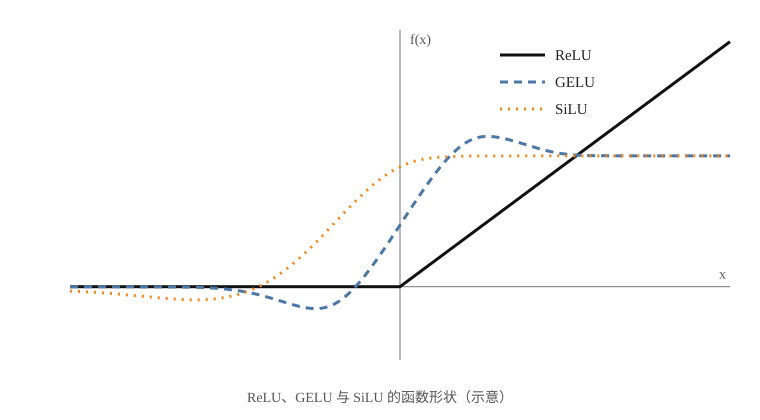
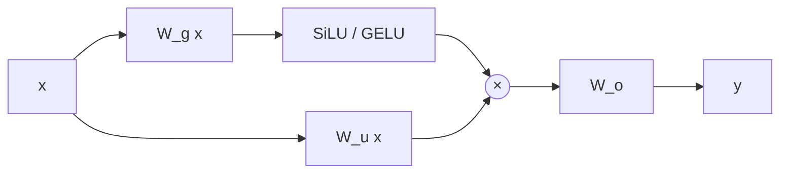

# 激活函数与FFN

[[预训练|返回上级：预训练]] · [[main|返回知识主干]]

围绕 Transformer FFN 中的激活函数、门控 MLP 与 SwiGLU / GEGLU 等结构整理 Q&A。

## 问题目录

- [[激活函数与FFN#ReLU、GELU 与 SwiGLU 在数学上有什么区别？|ReLU、GELU 与 SwiGLU 在数学上有什么区别？]]
- [[激活函数与FFN#如何理解 Gated MLP？SwiGLU 与 GEGLU 是什么关系？|如何理解 Gated MLP？SwiGLU 与 GEGLU 是什么关系？]]

---

## ReLU、GELU 与 SwiGLU 在数学上有什么区别？

**ReLU** 与 **GELU** 都是逐元素激活函数。ReLU 使用硬截断：

$$\operatorname{ReLU}(x)=\max(0,x)$$

负值直接变为 0，正值原样通过。GELU 则使用标准正态分布的累积分布函数 $\Phi(x)$ 对输入进行平滑加权：

$$\operatorname{GELU}(x)=x\Phi(x)$$

因此 ReLU 可以理解为 **hard gate**，GELU 则是连续、可微的 **soft gate**，负值附近不会被突然截断。

SwiGLU 不再只是一个一元激活函数，而是门控 FFN：

$$\operatorname{SwiGLU}(x)=W_o\left[\operatorname{SiLU}(W_gx)\odot(W_ux)\right]$$

其中 $\operatorname{SiLU}(z)=z\sigma(z)$。它从单路的 $\phi(Wx)$ 变为两路投影之间的乘法交互：一条产生 gate，一条产生 value，使一组输入相关特征能够动态调制另一组特征。

> 图中绘制的是 SwiGLU 门控分支使用的 **SiLU**；SwiGLU 本身是 Gated MLP 结构，不能画成单一的一元函数曲线。

参考：[GELU](https://arxiv.org/abs/1606.08415) · [GLU Variants Improve Transformer](https://arxiv.org/abs/2002.05202)

---

## 如何理解 Gated MLP？SwiGLU 与 GEGLU 是什么关系？

**Gated MLP** 是比 SwiGLU、GEGLU 更高一层的结构概念。典型形式为：

$$\operatorname{GatedMLP}(x)=W_o\left[\phi(W_gx)\odot(W_ux)\right]$$

$W_gx$ 是 **gate branch**，$W_ux$ 是 **value branch**，$\phi$ 决定具体的门控形式。常见 GLU 变体只是选择了不同的 gate activation：

| 结构 | Gate activation |
|---|---|
| **GLU** | Sigmoid |
| **GEGLU** | GELU |
| **SwiGLU** | SiLU / Swish |

与普通 MLP 的单路非线性相比，Gated MLP 引入了 **input-dependent multiplicative gating**：模型可以根据当前输入学习某类特征应被放大、减弱还是抑制，同时获得更丰富的特征交互。

参考：[GLU Variants Improve Transformer](https://arxiv.org/abs/2002.05202)
