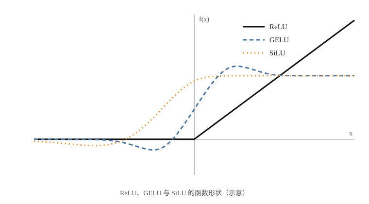
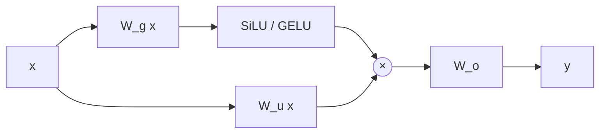
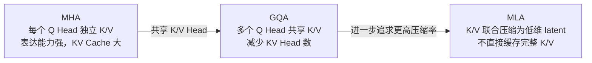

# 预训练

[[LLM|返回上级：LLM]] · [[main|返回知识主干]]

围绕大语言模型预训练阶段的目标、数据与基础能力形成整理 Q&A。

## 子树

| 子树 | 内容 |
| --- | --- |
| [[RoPE]] | 旋转位置编码、长上下文扩展与频谱设计 |

## 问题目录

- [[预训练#什么是预训练？|什么是预训练？]]
- [[预训练#主流的大模型预训练算法有什么？|主流的大模型预训练算法有什么？]]
- [[预训练#现代 LLM 预训练的数据是什么样的？|现代 LLM 预训练的数据是什么样的？]]
- [[预训练#预训练数据为什么要做安全过滤？|预训练数据为什么要做安全过滤？]]
- [[预训练#预训练数据为什么要做分类？|预训练数据为什么要做分类？]]
- [[预训练#现代 LLM 预训练的模型架构是什么样的？|现代 LLM 预训练的模型架构是什么样的？]]
- [[预训练#ReLU、GELU 与 SwiGLU 在数学上有什么区别？|ReLU、GELU 与 SwiGLU 在数学上有什么区别？]]
- [[预训练#如何理解 Gated MLP？SwiGLU 与 GEGLU 是什么关系？|如何理解 Gated MLP？SwiGLU 与 GEGLU 是什么关系？]]
- [[预训练#LayerNorm 与 RMSNorm 有什么区别？为什么现代 LLM 大量采用 RMSNorm？|LayerNorm 与 RMSNorm 有什么区别？为什么现代 LLM 大量采用 RMSNorm？]]
- [[预训练#为什么现代 LLM 普遍从 Post-Norm 转向 Pre-Norm？|为什么现代 LLM 普遍从 Post-Norm 转向 Pre-Norm？]]
- [[预训练#QK-Norm 是什么？它为什么能提高训练稳定性？|QK-Norm 是什么？它为什么能提高训练稳定性？]]
- [[预训练#Kimi K3 的残差结构与传统残差有什么不同？它起什么作用？|Kimi K3 的残差结构与传统残差有什么不同？它起什么作用？]]
- [[预训练#MHA 的基本原理是什么？|MHA 的基本原理是什么？]]
- [[预训练#GQA 如何在 MHA 上降低 KV Cache？|GQA 如何在 MHA 上降低 KV Cache？]]
- [[预训练#MLA 的基本原理是什么？|MLA 的基本原理是什么？]]
- [[预训练#为什么注意力结构会从 MHA 发展到 GQA，再到 MLA？|为什么注意力结构会从 MHA 发展到 GQA，再到 MLA？]]
- [[预训练#MLA 中的低秩降维是怎么做的？降维之后又是怎么恢复的？|MLA 中的低秩降维是怎么做的？降维之后又是怎么恢复的？]]
- [[预训练#为什么 MLA 里的 RoPE 要换成 Decoupled RoPE？|为什么 MLA 里的 RoPE 要换成 Decoupled RoPE？]]
- [[预训练#现代 LLM 的预训练系统是什么样的？|现代 LLM 的预训练系统是什么样的？]]
- [[预训练#现代 LLM 预训练常见的辅助目标有哪些？|现代 LLM 预训练常见的辅助目标有哪些？]]
- [[预训练#MTP 怎么做？|MTP 怎么做？]]
- [[预训练#FIM 在训练时，将前缀和后缀作为上下文输入，会打上标注吗？实现的是什么样的能力？|FIM 在训练时，将前缀和后缀作为上下文输入，会打上标注吗？实现的是什么样的能力？]]
- [[预训练#MoE 怎么做？|MoE 怎么做？]]
- [[预训练#Auxiliary-Loss-Free 的 Bias 是怎么帮助 specialization？|Auxiliary-Loss-Free 的 Bias 是怎么帮助 specialization？]]

---

## 什么是预训练？

预训练（Pre-training）是使用大规模通用文本、代码等数据训练语言模型基础能力的阶段，通常采用自监督语言建模目标，让模型通过预测 Token 学习数据中的统计规律。

这一阶段主要让模型形成语言理解与生成、世界知识、代码与数学模式以及基础推理等通用能力，最终得到能够继续开发的 **Base Model（基础模型）**。

> **预训练的核心是从大规模数据中学习广泛的知识与通用能力，并将其编码进模型参数。**

---

## 主流的大模型预训练算法有什么？

这里的“算法”主要指 **预训练目标（training objective）**。当前生成式 LLM 的绝对主流仍然是 **Causal Language Modeling（CLM）/ Next-Token Prediction（NTP）**。

| 预训练目标 | 当前定位 |
|---|---|
| **CLM / NTP** | 现代 decoder-only 生成式 LLM 的核心预训练目标 |
| **Multi-Token Prediction（MTP）** | NTP 的增强目标，同时预测后续多个 Token |
| **Masked Language Modeling（MLM）** | BERT 类 Encoder 模型的经典目标 |
| **Span Corruption / Denoising** | T5 等 Encoder-Decoder 模型常见 |
| **Fill-in-the-Middle（FIM）** | Code LLM 中常见的辅助目标 |

> **现代通用生成式 LLM 的预训练主干仍是 NTP；MTP、FIM 等通常作为增强或辅助目标。**

---

## 现代 LLM 预训练的数据是什么样的？

现代预训练通常使用大规模、多领域的数据混合，包括 Web 文本、书籍、百科、论文、代码、数学与 STEM、多语言和长文本等，也可能加入部分合成数据。

数据处理重点包括 **去重、质量过滤、安全过滤、领域与语言分类、污染检查和数据配比**。核心趋势是从单纯扩大规模转向同时重视 **规模、质量、多样性与合理配比**。

---

## 预训练数据为什么要做安全过滤？

安全过滤用于减少模型学习或记忆明显不应保留的内容，如隐私与敏感信息、高风险内容、恶意代码和严重污染数据。

其核心目的是 **控制 Base Model 学到什么，并降低后续的安全、隐私与合规风险**。

---

## 预训练数据为什么要做分类？

数据分类主要包括 **领域分类与语言分类**，用于看清并控制训练数据分布。

- **领域分类**：控制代码、数学、科学、通用文本等不同领域的数据配比，从而塑造不同能力。
- **语言分类**：控制不同语言的数据占比，避免高资源语言过度主导，并支持多语言能力。

> **数据分类本质上服务于 data mixture：决定不同类型的数据各学多少。**

---

## 现代 LLM 预训练的模型架构是什么样的？

主流仍是 **Decoder-only Transformer**。常见形态包括：

- **Dense Model**：每个 Token 使用大部分模型参数。
- **MoE（Mixture of Experts）**：每个 Token 只激活部分 Expert，以较低计算量扩展模型容量。

常见组件还包括 **RoPE、RMSNorm、SwiGLU、GQA/MQA、MLA** 等。总体方向是在保持 Transformer 主干的同时，提高模型容量、上下文能力和计算效率。
MoE 提升参数容量，GQA / MLA 降低 KV 成本，Local / Sparse / Linear Attention 解决长上下文计算，RoPE 系列解决位置表示，而 RMSNorm + SwiGLU 已逐渐成为相对成熟的基础组件。

延伸阅读：[[RoPE|RoPE 的原理、长上下文扩展与现代演进]]。

---

## ReLU、GELU 与 SwiGLU 在数学上有什么区别？

**ReLU** 与 **GELU** 都是逐元素激活函数。ReLU 使用硬截断：

$$\operatorname{ReLU}(x)=\max(0,x)$$

负值直接变为 0，正值原样通过。GELU 则使用标准正态分布的累积分布函数 $\Phi(x)$ 对输入进行平滑加权：

$$\operatorname{GELU}(x)=x\Phi(x)$$

因此 ReLU 可以理解为 **hard gate**，GELU 则是连续、可微的 **soft gate**，负值附近不会被突然截断。

SwiGLU 不再只是一个一元激活函数，而是门控 FFN：

$$\operatorname{SwiGLU}(x)=W_o\left[\operatorname{SiLU}(W_gx)\odot(W_ux)\right]$$

其中 $\operatorname{SiLU}(z)=z\sigma(z)$。它从单路的 $\phi(Wx)$ 变为两路投影之间的乘法交互：一条产生 gate，一条产生 value，使一组输入相关特征能够动态调制另一组特征。

> 图中绘制的是 SwiGLU 门控分支使用的 **SiLU**；SwiGLU 本身是 Gated MLP 结构，不能画成单一的一元函数曲线。

参考：[GELU](https://arxiv.org/abs/1606.08415) · [GLU Variants Improve Transformer](https://arxiv.org/abs/2002.05202)

---

## 如何理解 Gated MLP？SwiGLU 与 GEGLU 是什么关系？

**Gated MLP** 是比 SwiGLU、GEGLU 更高一层的结构概念。典型形式为：

$$\operatorname{GatedMLP}(x)=W_o\left[\phi(W_gx)\odot(W_ux)\right]$$

$W_gx$ 是 **gate branch**，$W_ux$ 是 **value branch**，$\phi$ 决定具体的门控形式。常见 GLU 变体只是选择了不同的 gate activation：

| 结构 | Gate activation |
|---|---|
| **GLU** | Sigmoid |
| **GEGLU** | GELU |
| **SwiGLU** | SiLU / Swish |

与普通 MLP 的单路非线性相比，Gated MLP 引入了 **input-dependent multiplicative gating**：模型可以根据当前输入学习某类特征应被放大、减弱还是抑制，同时获得更丰富的特征交互。

参考：[GLU Variants Improve Transformer](https://arxiv.org/abs/2002.05202)

---

## LayerNorm 与 RMSNorm 有什么区别？为什么现代 LLM 大量采用 RMSNorm？

对 Hidden State $x\in\mathbb{R}^d$，**LayerNorm** 同时进行中心化和尺度归一化：

$$\operatorname{LayerNorm}(x)=\gamma\frac{x-\mu}{\sqrt{\sigma^2+\epsilon}}+\beta$$

其中 $\mu$ 是均值，$\sigma^2$ 是方差。

**RMSNorm** 则省去均值中心化，只控制向量尺度：

$$\operatorname{RMSNorm}(x)=\gamma\frac{x}{\sqrt{\frac{1}{d}\sum_i x_i^2+\epsilon}}$$

因此可以概括为：**LayerNorm = re-centering + re-scaling；RMSNorm = re-scaling**。

RMSNorm 保留了深层网络中很重要的尺度控制作用，同时计算更简单、容易高效实现，并在大型 Decoder Transformer 中表现稳定。因此现代 LLM 大量采用 RMSNorm，但这并不意味着它在所有模型和任务上都严格优于 LayerNorm。

参考：[Root Mean Square Layer Normalization](https://arxiv.org/abs/1910.07467)

---

## 为什么现代 LLM 普遍从 Post-Norm 转向 Pre-Norm？

两者的区别在于归一化相对子层与残差连接的位置：

$$\text{Post-Norm:}\qquad x_{l+1}=\operatorname{Norm}(x_l+F(x_l))$$

$$\text{Pre-Norm:}\qquad x_{l+1}=x_l+F(\operatorname{Norm}(x_l))$$

Post-Norm 中，反向梯度经过每一层时都必须穿过 Norm 的 Jacobian；随着网络加深，更容易出现梯度尺度不稳定。Pre-Norm 的导数包含显式的 identity path：

$$\frac{\partial x_{l+1}}{\partial x_l}=I+J_FJ_{Norm}$$

其中的 $I$ 让梯度可以沿残差支路直接跨层传播，因此深层 Transformer 通常更容易稳定优化，也降低了对初始化和学习率设置的敏感性。

Pre-Norm 的代价之一是各层输出长期累加到 residual stream，深层时可能出现表示稀释；这也成为后续残差结构继续改进的动机之一。

参考：[On Layer Normalization in the Transformer Architecture](https://arxiv.org/abs/2002.04745)

---

## QK-Norm 是什么？它为什么能提高训练稳定性？

标准 Attention 的 logit 为：

$$s_{ij}=\frac{q_i^Tk_j}{\sqrt{d}}$$

而点积可以写成：

$$q^Tk=\lVert q\rVert\lVert k\rVert\cos\theta$$

因此 Attention logit 不仅取决于 Query 与 Key 的方向相似度，也受二者模长影响。若训练过程中 $\lVert Q\rVert$ 或 $\lVert K\rVert$ 持续增大，logit 会变得极端，使 Softmax 接近饱和并削弱有效梯度。

**QK-Norm** 在计算 $QK^T$ 前分别归一化 Query 和 Key：

$$\hat Q=\operatorname{Norm}(Q),\qquad \hat K=\operatorname{Norm}(K)$$

再使用 $\hat Q\hat K^T$ 计算 Attention。它通过直接约束 Q/K 的尺度，抑制 Attention logit 无控制增长，从而减少 Softmax 饱和和训练不稳定。实际模型可使用 RMSNorm 等归一化方式，并不一定采用严格的 L2 normalization。

> **RMSNorm 主要控制 Transformer Hidden State 的尺度；QK-Norm 专门控制 Attention 内部 Q/K 及其 logit 的尺度。**

参考：[QK-Norm](https://aclanthology.org/2020.findings-emnlp.379/) · [Qwen3 Technical Report](https://arxiv.org/abs/2505.09388)

---

## Kimi K3 的残差结构与传统残差有什么不同？它起什么作用？

传统 Pre-Norm Transformer 使用固定加法残差：

$$x_{l+1}=x_l+F_l(\operatorname{Norm}(x_l))$$

展开后，历史各层输出会以固定权重不断累加。随着深度增加，单个早期层表示在 residual stream 中的相对贡献可能逐渐被稀释。

Kimi K3 引入 **Attention Residuals（AttnRes）**：不再默认把所有历史表示等权相加，而是对先前表示计算输入相关的注意力权重：

$$h_l=\sum_{i<l}\alpha_{i,l}v_i$$

因此可以把普通 Attention 与 AttnRes 分别理解为：**前者沿序列维度选择 Token 信息，后者沿深度维度选择历史层信息**。模型能够按当前表示动态决定应更多读取哪些较早的表示，从而缓解 Pre-Norm 的 depth dilution，并改善跨深度的信息流和梯度分布。

完整 AttnRes 需要保留大量历史层表示。Kimi K3 实际采用 **Block AttnRes**：Block 内仍使用普通残差累加，Block 之间再进行 attention-based aggregation，以降低显存和跨流水线通信开销。

> **传统 Residual 是固定的逐层累加；AttnRes 将跨深度的信息汇聚改成可学习、输入相关的选择。**

参考：[Attention Residuals](https://arxiv.org/abs/2603.15031) · [Kimi K3 Technical Report](https://arxiv.org/abs/2607.24653)

---

## MHA 的基本原理是什么？

**Multi-Head Attention（MHA）** 先将 Hidden State 分别线性投影为 Query、Key、Value：

$$Q=XW^Q,\qquad K=XW^K,\qquad V=XW^V$$

单个 Head 的注意力为：

$$\operatorname{Attention}(Q,K,V)=\operatorname{softmax}\left(\frac{QK^T}{\sqrt{d_h}}+M\right)V$$

其中 Query 表示当前 Token 要匹配的信息，Key 用于与 Query 计算相关性，Value 是被注意力权重聚合的内容。MHA 使用多个独立 Head，每个 Head 拥有自己的 $Q/K/V$ 投影，最后将各 Head 输出拼接并再次投影。

在自回归推理中，历史 Token 的 K/V 不会改变，因此会保存为 **KV Cache**。若有 $H$ 个 Head，每个 Head 维度为 $d_h$，则每层每个 Token 需要缓存约：

$$2Hd_h$$

个 K/V 元素。长上下文、大 Batch 和多层模型下，KV Cache 会成为显存容量与显存带宽的重要瓶颈。

参考：[Attention Is All You Need](https://arxiv.org/abs/1706.03762)

---

## GQA 如何在 MHA 上降低 KV Cache？

**Grouped-Query Attention（GQA）** 保留多个独立 Query Head，但让一组 Query Head **共享同一套 Key/Value Head**。

若 MHA 有 $H$ 个 Query Head，也有 $H$ 组 K/V；GQA 只保留 $G$ 组 K/V（$1<G<H$），则 KV Cache 从：

$$2Hd_h$$

降低为：

$$2Gd_h$$

因此缓存量约缩小为原来的 $G/H$。MHA 可以看作 $G=H$ 的特例，MQA 则是 $G=1$ 的极端情况。

GQA 的核心取舍是：**牺牲一部分 K/V Head 的独立表示能力，换取显著更小的 KV Cache 和更高的解码效率，同时尽量保持接近 MHA 的模型质量。**

参考：[GQA: Training Generalized Multi-Query Transformer Models from Multi-Head Checkpoints](https://arxiv.org/abs/2305.13245)

---

## MLA 的基本原理是什么？

**Multi-Head Latent Attention（MLA）** 不再主要通过“减少 K/V Head 数量”压缩缓存，而是将所有 Head 的 K/V 信息先联合压缩到一个低维 **latent vector**：

$$c_t^{KV}=W^{DKV}h_t$$

再通过不同的上投影得到各 Head 所需的内容 Key 和 Value：

$$k_t^C=W^{UK}c_t^{KV},\qquad v_t^C=W^{UV}c_t^{KV}$$

推理时主要缓存低维 $c_t^{KV}$，而不是每个 Head 的完整 K/V。借助矩阵乘法结合律，还可以进行 **weight absorption**，将上投影矩阵吸收到 Query / Output 投影中，使解码时不必真正恢复完整 K/V。

MLA 另外使用一条独立的 **Decoupled RoPE** 路径保存位置相关的 Key。因此实际缓存主要由低维 $c_t^{KV}$ 和较小的 RoPE Key 构成。

参考：[DeepSeek-V2 Technical Report](https://arxiv.org/abs/2405.04434)

---

## 为什么注意力结构会从 MHA 发展到 GQA，再到 MLA？

这更适合作为一条**问题驱动的理解路线**，而不是严格的历史替代关系：GQA 和 MLA 都是在缓解 MHA 的 KV Cache 与解码内存带宽瓶颈，只是压缩方式不同。

- **MHA**：每个 Query Head 都有独立 K/V，表达自由度高，但 KV Cache 随 Head 数增长。
- **GQA**：通过 Head Sharing 减少 K/V 数量，在质量和推理效率之间折中。
- **MLA**：进一步从“减少 K/V Head”转向“压缩 K/V 表示本身”，用低维 latent 保存多个 Head 共享的基础信息，再通过投影保持多头表达能力。

三者都仍采用标准的注意力匹配思想，也都没有从根本上消除 Full Attention 随序列长度增长的二次计算复杂度；这里主要优化的是 **KV Cache 宽度和自回归解码效率**。

参考：[GQA](https://arxiv.org/abs/2305.13245) · [DeepSeek-V2](https://arxiv.org/abs/2405.04434)

---

## MLA 中的低秩降维是怎么做的？降维之后又是怎么恢复的？

MLA 将原本直接从 Hidden State 生成完整多头 K/V 的大投影，拆成 **Down Projection + Up Projection**：

$$h_t\in\mathbb{R}^{d}\xrightarrow{W^{DKV}}c_t^{KV}\in\mathbb{R}^{d_c}\xrightarrow{W^{UK},W^{UV}}(k_t^C,v_t^C)$$

其中 $d_c\ll Hd_h$。$W^{DKV}$ 将 Hidden State 压缩成低维 latent $c_t^{KV}$，这个 latent 联合承载 K/V 所需的信息；$W^{UK}$ 和 $W^{UV}$ 再分别把它上投影到完整的多头 Key / Value 表示空间。

从矩阵角度，相当于把原本的大投影近似限制为低秩分解：

$$W^K\approx W^{UK}W^{DKV},\qquad W^V\approx W^{UV}W^{DKV}$$

训练时这些矩阵共同学习，因此“恢复”并不是无损解压原始向量，而是模型学习 **怎样从有限维 latent 中生成完成注意力计算所需要的 K/V 表示**。

推理时通常无需真的把完整 K/V 恢复到显存中。以 Key 为例：

$$q^Tk=q^TW^{UK}c^{KV}=\left((W^{UK})^Tq\right)^Tc^{KV}$$

因此可把 $W^{UK}$ 吸收到 Query 侧投影；Value 的 $W^{UV}$ 也可吸收到输出投影。最终缓存的核心对象仍是低维 $c^{KV}$。

参考：[DeepSeek-V2 Technical Report](https://arxiv.org/abs/2405.04434)

---

## 为什么 MLA 里的 RoPE 要换成 Decoupled RoPE？

MLA 高效推理依赖 **weight absorption**。如果像标准 Attention 一样直接对内容 Key $k_t^C=W^{UK}c_t^{KV}$ 使用 RoPE，就会变成：

$$\operatorname{RoPE}_t(W^{UK}c_t^{KV})$$

RoPE 的旋转矩阵依赖 Token 位置 $t$，因此一个位置相关的变换会夹在 Query 与 $W^{UK}$ 之间，$W^{UK}$ 无法再被固定地吸收到 Query 投影中。这样就会破坏“只缓存 latent、直接在 latent 空间计算”的高效路径。

MLA 因此把**内容表示和位置表示解耦**：

- 内容分支 $q^C/k^C$ 使用低秩 latent compression，不直接施加 RoPE；
- 额外生成较小的 $q^R/k^R$ 专门施加 RoPE；
- 最终将两部分拼接后计算 Attention。

形式上：

$$q_{t,i}=[q_{t,i}^{C};q_{t,i}^{R}],\qquad k_{t,i}=[k_{t,i}^{C};k_t^{R}]$$

其中 $k_t^R$ 可在所有 Head 间共享。这样既保留了相对位置信息，又不会破坏内容 K/V 的低秩压缩和 weight absorption；推理时只需额外缓存较小的 RoPE Key。

延伸阅读：[[RoPE|RoPE 的基本原理与频谱演进]]。

参考：[DeepSeek-V2 Technical Report](https://arxiv.org/abs/2405.04434)

---

## 现代 LLM 的预训练系统是什么样的？

现代预训练依赖大规模分布式训练，通过组合 **数据并行、张量并行、流水线并行、Expert 并行、Context/Sequence 并行** 等方式在大量加速卡上训练超大模型。

同时会使用 **BF16/FP8、FlashAttention、算子融合、Gradient Checkpointing、通信与计算重叠、Checkpoint 与故障恢复** 等技术，提高吞吐、降低显存与计算成本并保证训练稳定性。

---

## 现代 LLM 预训练常见的辅助目标有哪些？

主目标通常仍是 **NTP / CLM**，辅助目标用于增加额外训练信号或满足特定架构需求，常见包括：

- **MTP**：同时预测多个未来 Token。
- **FIM**：根据前后文补全中间内容，常见于代码模型。
- **MoE Routing / Load Balancing 约束**：避免 Expert 负载过度不均。

> 严格来说，MTP 属于辅助预测目标；FIM 更接近数据重排形成的训练任务，MoE Load Balancing 则属于路由约束。

---

## MTP 怎么做？

**Multi-Token Prediction（MTP）** 在普通 NTP 之外，让当前位置的表示继续承担更远未来 Token 的预测任务，从而增加训练信号，并促使 Hidden State 编码更多与后续序列有关的信息。

最直观的形式是让同一个位置分别预测 `t+1、t+2……`，并将这些预测损失与主 NTP Loss 一起优化。DeepSeek-V3 采用逐级的 MTP Module：上一层表示经过额外模块后继续预测更远的 Token；训练时使用额外 MTP Loss，普通推理时可以移除这些模块，不增加常规生成成本。

参考：[DeepSeek-V3 Technical Report](https://arxiv.org/abs/2412.19437)

---

## FIM 在训练时，将前缀和后缀作为上下文输入，会打上标注吗？实现的是什么样的能力？

会。**Fill-in-the-Middle（FIM）** 通常会使用专门的控制 Token 标识前缀、后缀和待补全部分，例如 `<PRE>`、`<SUF>`、`<MID>` 等模型约定的特殊 Token。

训练时先把原始序列切成 `Prefix / Middle / Suffix`，再重排为类似：

`<PRE> Prefix <SUF> Suffix <MID> Middle`

模型仍然执行普通 NTP，但由于 `<MID>` 之前已经看到了 Prefix 和 Suffix，并通过控制 Token 知道各部分的角色，因此逐渐学会 **根据左右两侧上下文生成能够连接二者的中间内容**。

FIM 训练得到的核心能力是 **局部条件补全（infilling）**，而不是更高层的任务规划或 Bug 定位能力。

对比阅读：[[对比问题#Agent 做补全或修 Bug，与 FIM 的差别在哪儿？|Agent 做补全或修 Bug，与 FIM 的差别在哪儿？]]。

参考：[Efficient Training of Language Models to Fill in the Middle](https://openai.com/index/efficient-training-of-language-models-to-fill-in-the-middle/)

---

## MoE 怎么做？

**Mixture of Experts（MoE）** 在部分网络层中设置多个 Expert，并用 **Router / Gate** 根据当前 Token 的 Hidden State 计算其与各 Expert 的匹配分数，只激活 Top-K Expert 参与计算。因此模型可以拥有很大的总参数量，同时控制每个 Token 的实际计算量。

训练中的关键问题是 **负载均衡**：若大量 Token 长期集中到少数 Expert，会导致计算负载不均，并影响 Expert 分工。传统方法通常加入 Load-Balancing Auxiliary Loss；DeepSeek-V3 则主要通过动态调整各 Expert 的路由 Bias 来控制流量：过载 Expert 的 Bias 降低，欠载 Expert 的 Bias 提高，从而在不过度干扰主语言建模目标的情况下改善负载分布。

参考：[DeepSeek-V3 Technical Report](https://arxiv.org/abs/2412.19437)

---

## Auxiliary-Loss-Free 的 Bias 是怎么帮助 specialization？

Expert specialization 的基础，是训练过程中不同类型 Token 与不同 Expert 之间逐渐形成稳定的 **affinity（匹配关系）**。但稀疏 Top-K Routing 会放大初始化阶段的微小随机差异：少数 Expert 如果过早获得更多 Token，就会得到更多梯度并继续吸引更多 Token，其他 Expert 则可能长期缺少训练信号，最终形成 routing collapse，而不是有意义的分工。

DeepSeek-V3 的 **Auxiliary-Loss-Free Load Balancing** 会根据整个 Batch 中各 Expert 实际收到的 Token 数动态调整路由 Bias：过载 Expert 降低 Bias，欠载 Expert 提高 Bias。Bias 只影响 Top-K 的选择边界，而实际 Expert 输出的 gating weight 仍由原始 affinity 决定。这样可以抑制少数 Expert 过早垄断流量，让更多 Expert 持续获得训练机会，同时尽量保留模型根据 Token 特征形成不同路由偏好的空间。

这里关键是它主要采用 **Batch-wise Balance**，而不是要求每条 Sequence 内都平均使用所有 Expert。一个代码序列仍可以集中路由到一组 Expert，数学或其他领域也可以集中到另一组 Expert；只要在更大的统计范围内没有少数 Expert 长期吞掉绝大多数流量即可。因此，负载均衡提供的是形成 specialization 的稳定训练条件，而具体分工仍由数据和语言建模目标驱动。

训练条件也会直接影响 specialization：

- **数据多样性**提供足够丰富、可区分的模式，使不同 Expert 有形成分工的基础；Expert 的分工未必对应人类可命名的领域，也可能对应语言、句法或更隐含的表示模式。
- **Data Mixture** 决定各种模式出现的比例。过度偏斜的 mixture 可能使某类 Token 长期主导路由，因此需要合理控制不同领域和语言的数据分布。
- **足够大的路由统计范围**使负载估计更接近整体数据分布。若只依据很小且恰好属于单一领域的 Batch 做均衡，可能把合理的领域 specialization 误判为过载；较大的 Global Batch、Micro-batch 或跨设备统计能降低这种噪声。

> **MoE specialization 来自异质数据与 Token–Expert affinity 的长期学习；Auxiliary-Loss-Free Bias 的作用是防止早期垄断和 Expert 饥饿，让这种分工能够稳定形成，而不是把所有 Expert 强行训练成相同能力。**

参考：[DeepSeek-V3 Technical Report](https://arxiv.org/abs/2412.19437)

---

相关主题：[[LLM]] · [[中训练]] · [[后训练]]
