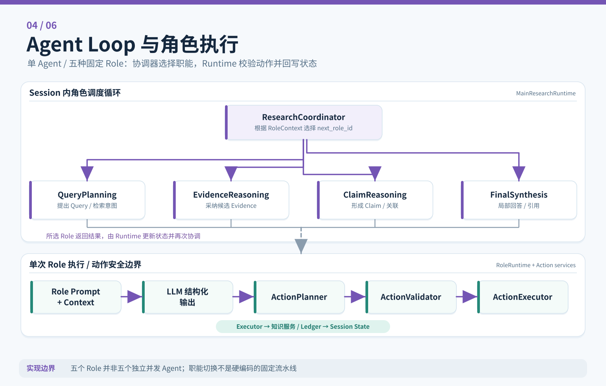

# Agent Loop 与角色执行

[返回上级：TransitScholar](../TransitScholar.md) · [返回知识主干](../../main.md)

多角色单 Agent、RoleRuntime、结构化 Prompt、角色切换、Action 校验与工具调用。本子树按实际实现、设计动机与工程边界组织 Q&A；以下 Q&A 根据实际代码编写，设计目标与默认已接通的功能分别说明。

## 架构图

> 图示边界：固定五种 Session Role 不是五个并发独立 Agent。角色职能由 Coordinator 决定，图中各职责并非严格固定顺序。
>
> 代码依据（`d077fb89aded`）：[main_runtime.py](https://github.com/XuanzheChen/transit-scholar/blob/d077fb89aded267bc7dc1e5fe33ec6b1e6504c49/src/transit_scholar/layer3/runtime/main_runtime.py) · [role_runtime.py](https://github.com/XuanzheChen/transit-scholar/blob/d077fb89aded267bc7dc1e5fe33ec6b1e6504c49/src/transit_scholar/layer3/runtime/role_runtime.py) · [builtin.py](https://github.com/XuanzheChen/transit-scholar/blob/d077fb89aded267bc7dc1e5fe33ec6b1e6504c49/src/transit_scholar/layer3/roles/builtin.py) · [roles.py](https://github.com/XuanzheChen/transit-scholar/blob/d077fb89aded267bc7dc1e5fe33ec6b1e6504c49/src/transit_scholar/product/roles.py) · [executor.py](https://github.com/XuanzheChen/transit-scholar/blob/d077fb89aded267bc7dc1e5fe33ec6b1e6504c49/src/transit_scholar/layer3/actions/executor.py)。

## 问题目录

- [[TransitScholar/Agent Loop 与角色执行/Agent Loop 与角色执行#TransitScholar 为什么采用多角色单 Agent，而不是多个独立 Agent？|TransitScholar 为什么采用多角色单 Agent，而不是多个独立 Agent？]]
- [[TransitScholar/Agent Loop 与角色执行/Agent Loop 与角色执行#为什么不使用langgraph？|为什么不使用langgraph？]]
- [[TransitScholar/Agent Loop 与角色执行/Agent Loop 与角色执行#五个内置 Role 的职责、输入和输出契约分别是什么？|五个内置 Role 的职责、输入和输出契约分别是什么？]]
- [[TransitScholar/Agent Loop 与角色执行/Agent Loop 与角色执行#如果给FinalSynthesis开放写的权限，应该如何保证写权限的隔离？不同工作区之间，如何保证写的权限不被滥用？|如果给FinalSynthesis开放写的权限，应该如何保证写权限的隔离？不同工作区之间，如何保证写的权限不被滥用？]]
- [[TransitScholar/Agent Loop 与角色执行/Agent Loop 与角色执行#ResearchCoordinator 如何决定下一轮 Role，MainResearchRuntime 如何推进循环？|ResearchCoordinator 如何决定下一轮 Role，MainResearchRuntime 如何推进循环？]]
- [[TransitScholar/Agent Loop 与角色执行/Agent Loop 与角色执行#StructuredLLMRolePolicy 如何构造 Prompt 并处理模型结构化输出？|StructuredLLMRolePolicy 如何构造 Prompt 并处理模型结构化输出？]]
- [[TransitScholar/Agent Loop 与角色执行/Agent Loop 与角色执行#模型调用工具时如何验证角色权限和资源归属？|模型调用工具时如何验证角色权限和资源归属？]]
- [[TransitScholar/Agent Loop 与角色执行/Agent Loop 与角色执行#LLM 输出异常、工具异常与预算耗尽分别怎样终止或重试？|LLM 输出异常、工具异常与预算耗尽分别怎样终止或重试？]]

---

## TransitScholar 为什么采用多角色单 Agent，而不是多个独立 Agent？

项目的研究职能固定，主要变化的是“现在做哪一步”，因此采用**一个 Session Runtime + 五种预定义 Role**。每次切换时选新的 Prompt、ContextPolicy、输入输出契约和 Action 权限，但共享同一 Session 的权威状态。相比独立多 Agent，减少了并发协调、消息协议和状态冲突；代价是角色不能任意动态扩展，也没有并行专家协作。实现并不依赖 LangGraph 来驱动这条循环。 参见：[固定 Role 定义](https://github.com/XuanzheChen/transit-scholar/blob/d077fb89aded267bc7dc1e5fe33ec6b1e6504c49/src/transit_scholar/layer3/roles/builtin.py#L72)、[Session 主循环](https://github.com/XuanzheChen/transit-scholar/blob/d077fb89aded267bc7dc1e5fe33ec6b1e6504c49/src/transit_scholar/layer3/runtime/main_runtime.py#L273)。

## 为什么不使用langgraph？

**因为当前项目的研究角色固定，真正需要控制的是“下一步由谁执行、执行什么、失败后如何恢复”。** 用 Python 自己管理这条循环，能直接控制状态保存、工具权限、执行预算和中断恢复，减少额外框架适配，调试也更容易追踪。

**这不是说 LangGraph 做不到。** 它同样支持状态编排和流程控制；只是目前这套流程比较明确，引入它未必能抵消改造成本。如果将来需要复杂分支、并行角色或更灵活的工作流，再评估使用它更合理。

## 五个内置 Role 的职责、输入和输出契约分别是什么？

五种角色分别是：① ResearchCoordinator 观察进度并选择下一职能；② QueryPlanning 提议并检索 Query；③ EvidenceReasoning 从检索结果中挑选值得采纳的 Evidence ID；④ ClaimReasoning 基于已采纳证据提出 Claim 及关联；⑤ FinalSynthesis 形成含引用的 Session 回答。各角色的 `input_contract` / `output_contract` 是不同的 Pydantic 类型，所需 Context 和允许动作也独立配置。 参见：[Role 契约](https://github.com/XuanzheChen/transit-scholar/blob/d077fb89aded267bc7dc1e5fe33ec6b1e6504c49/src/transit_scholar/layer3/roles/builtin.py#L72)、[输入输出模型](https://github.com/XuanzheChen/transit-scholar/blob/d077fb89aded267bc7dc1e5fe33ec6b1e6504c49/src/transit_scholar/layer3/agent/models.py#L42)。

## 如果给FinalSynthesis开放写的权限，应该如何保证写权限的隔离？不同工作区之间，如何保证写的权限不被滥用？

如果允许它写入，应只开放明确的操作，例如“保存最终摘要”，而不是直接读写数据库或文件。执行前由后端核对当前角色、用户所属工作区、任务归属和允许修改的对象；**工作区身份必须从可信的任务记录获得，不能只相信模型传入的编号**。

写入时还要验证引用来源、使用事务和版本检查防止覆盖，并记录操作日志。通过跨工作区越权测试验证：即使模型要求修改其他工作区的数据，也必须在执行前被拒绝。

## ResearchCoordinator 如何决定下一轮 Role？

协调role会读取一个结构化的其他role列表，由对role的简短说明，role拥有的工具等信息组成。这是 决策下一个role的部分信息基础。同时，runtime会收集session handoff，query，evidence，claim，role handoff，根据研究问题构建成完整context，然后

帮我完善这一段！！！

## StructuredLLMRolePolicy 如何构造 Prompt 并处理模型结构化输出？

它把当前 Role 的提示词模板放入 system 消息；把经过校验的 输入、上下文、当前 工作状态等信息放入 user JSON，然后生成结构化的提示词。每个模型的输出都会经过其特有的输出校验器，主要校验其输出的字段；不合格会在有限预算内携带错误信息重问；临时 Provider 错误也有单独的有限重试。Role 不能依靠一段自然语言自行越过结构化输出契约。 

## 模型调用工具时如何验证角色权限和资源归属？

先检查模型调用时的输入结构，字段是否合法，在检查当前 Role 是否有对应的工具；随后校验 Workspace、Run、Session 归属，以及所引用的 Query/Claim/Evidence 是否在当前 Session 中存在。验证通过后执行器分派给具体的service。这样 **LLM 无法仅通过输出文字直接写数据库或调用任意工具**。

## LLM 输出异常、工具异常与预算耗尽分别怎样终止或重试？

RoleRuntime 会将错误分开处理：Provider 临时故障在 `provider_retry_limit` 内重试；Pydantic 输出验证失败在 `structured_output_repair_limit` 内重问；Action 报错会记录失败并让 Session Runtime 按失败预算处理。Role、Session 和 Run 都有独立的步数/调用上限，达到上限会终止而不是无限循环。而每次失败重试，都会在prompt末尾注入一段临时的错误信息，降低 再次犯错的可能性。**但如果是工具调用结果不可获得或者没有明确失败时，会保守地终止调用**。 