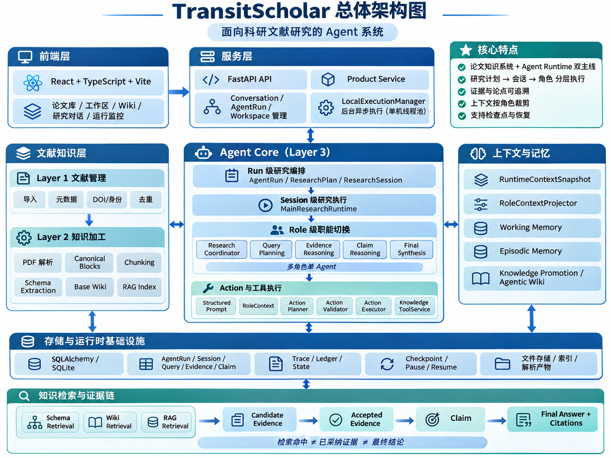

# TransitScholar

[返回知识主干](../main.md)

本 Tree 用于记录 [TransitScholar](https://github.com/XuanzheChen/transit-scholar) 科研 Agent 项目的实际架构、设计动机、代码机制与工程限制。相关通用原理可延伸阅读 [[Agent/Agent|Agent]]、[[Agent/Context/context|Context]]、[[Agent/Context/RAG/RAG|RAG]]、[[Agent/Context/Memory/Memory|Memory]] 和 [[backend/backend|后端开发]]。项目相关事实以**具体提交、实际代码和测试**为依据，避免将设计意图与已验证效果混同。

## 总体架构图

> 图示用于总体结构导航，描述论文知识层、服务层、Agent Core、上下文与记忆、运行时持久化及证据链之间的关系。它是概要示意，并不表示所有可选组件都已接入默认生产路径。后续写 Q&A 时，需逐项核实该界限。

## 子树

| 子树 | 内容 |
| --- | --- |
| [系统架构与服务层](系统架构与服务层/系统架构与服务层.md) | 前端、FastAPI、Product Service、后台执行管理和数据持久化的调用边界 |
| [文献处理与知识构建](文献处理与知识构建/文献处理与知识构建.md) | 论文身份、PDF 解析、Canonical Blocks、Chunking、Schema 与 Base Wiki 构建 |
| [知识检索与证据链](知识检索与证据链/知识检索与证据链.md) | Schema、Wiki、RAG 混合检索以及 Query、Evidence、Claim 和来源约束 |
| [工具](工具/工具.md) | Agent 可用的检索工具、结构化 Action、角色权限和默认装配边界 |
| [研究规划与会话编排](研究规划与会话编排/研究规划与会话编排.md) | RunCoordinator、ResearchPlan、PlanItem、ResearchSession 和研究结果汇总 |
| [Agent Loop 与角色执行](Agent%20Loop%20与角色执行/Agent%20Loop%20与角色执行.md) | 多角色单 Agent、RoleRuntime、结构化 Prompt、角色切换、Action 校验与工具调用 |
| [上下文与记忆](上下文与记忆/上下文与记忆.md) | Context Snapshot、RoleContext Projection、Working Memory、Episodic Memory、Agentic Wiki |
| [运行时状态与可靠性](运行时状态与可靠性/运行时状态与可靠性.md) | Research State、Trace、Checkpoint、执行预算、暂停恢复、重试和测试 |

## 问题目录

- [[TransitScholar/TransitScholar#TransitScholar 要解决什么科研工作流问题，和普通论文问答 RAG 有什么不同？|TransitScholar 要解决什么科研工作流问题，和普通论文问答 RAG 有什么不同？]]
- [[TransitScholar/TransitScholar#TransitScholar 从用户研究问题到最终回答的完整执行链路是什么？|TransitScholar 从用户研究问题到最终回答的完整执行链路是什么？]]
- [[TransitScholar/TransitScholar#论文知识构建与 Agent Runtime 为什么采用两条相互独立又协作的主线？|论文知识构建与 Agent Runtime 为什么采用两条相互独立又协作的主线？]]
- [[TransitScholar/TransitScholar#TransitScholar 的主要工程取舍、已实现边界与尚待验证的问题是什么？|TransitScholar 的主要工程取舍、已实现边界与尚待验证的问题是什么？]]
- [[TransitScholar/TransitScholar#SQLAlchemy和Alembic在项目中起到了什么作用？为什么使用它们而不是用其他技术栈呢？|SQLAlchemy和Alembic在项目中起到了什么作用？为什么使用它们而不是用其他技术栈呢？]]
- [[TransitScholar/TransitScholar#你会如何调试这个agent core？|你会如何调试这个agent core？]]

---

## TransitScholar 要解决什么科研工作流问题，和普通论文问答 RAG 有什么不同？

它解决的不是单次论文问答，而是**持续研究**：先把论文整理成可检索、可定位的材料，再让 Agent 规划子问题、逐轮收集证据、形成论点和引用，最后把结果沉淀为可复用知识。普通 RAG 通常检索一次就生成回答；这里把 Query、Evidence、Claim、研究会话和运行状态分别管理，便于检查与恢复。 参见：[RunResearchRuntime](https://github.com/XuanzheChen/transit-scholar/blob/d077fb89aded267bc7dc1e5fe33ec6b1e6504c49/src/transit_scholar/layer3/runtime/run_runtime.py#L152)、[研究账本](https://github.com/XuanzheChen/transit-scholar/blob/d077fb89aded267bc7dc1e5fe33ec6b1e6504c49/src/transit_scholar/layer3/ledger/service.py#L97)。

## TransitScholar 从用户研究问题到最终回答的完整执行链路是什么？

典型路径是：React 提交消息 → FastAPI 创建 ConversationTurn 和 AgentRun → LocalExecutionManager 后台执行 → RunCoordinator 决定直接研究或先制订计划 → 一个个 ResearchSession 内由固定角色完成检索、证据筛选、论点构建与综合 → Run 级汇总 → 回写回答与引用。完成后还会尝试运行记忆沉淀流程。前端通过状态和 Timeline 接口轮询进度。 参见：[提交入口](https://github.com/XuanzheChen/transit-scholar/blob/d077fb89aded267bc7dc1e5fe33ec6b1e6504c49/src/transit_scholar/api/routers/conversations.py#L127)、[任务执行](https://github.com/XuanzheChen/transit-scholar/blob/d077fb89aded267bc7dc1e5fe33ec6b1e6504c49/src/transit_scholar/product/research.py#L52)、[Run 编排](https://github.com/XuanzheChen/transit-scholar/blob/d077fb89aded267bc7dc1e5fe33ec6b1e6504c49/src/transit_scholar/layer3/runtime/run_runtime.py#L152)。

## 论文知识构建与 Agent Runtime 为什么采用两条相互独立又协作的主线？

知识主线的输入是 PDF，产出带来源定位的 Chunk、Schema、Wiki 等；执行主线的输入是研究目标，产出 Query、Evidence、Claim、SessionOutcome 和回答。两者通过 WorkspaceKnowledgeGateway、KnowledgeToolService 连接。分离后可以独立更新解析或检索方法，而不必改动 Agent 的职责与状态机。 参见：[文献流水线](https://github.com/XuanzheChen/transit-scholar/blob/d077fb89aded267bc7dc1e5fe33ec6b1e6504c49/src/transit_scholar/layer2/pipeline.py#L61)、[知识网关](https://github.com/XuanzheChen/transit-scholar/blob/d077fb89aded267bc7dc1e5fe33ec6b1e6504c49/src/transit_scholar/layer3/knowledge/gateway.py#L113)、[运行时装配](https://github.com/XuanzheChen/transit-scholar/blob/d077fb89aded267bc7dc1e5fe33ec6b1e6504c49/src/transit_scholar/product/runtime.py#L89)。

## TransitScholar 的主要工程取舍、已实现边界与尚待验证的问题是什么？

主要取舍是：固定角色而非动态多 Agent；Python 管控状态与 Action，LLM 做语义判断；单机线程池而非分布式队列；证据必须可追溯。边界也要说清：跨论文 WorkspaceRagRetriever 虽已实现，但默认工厂没有直接注入；引用 ID 合法不等于科学论证正确；SQL 与文件检查点不是同一个事务，恢复采取保守策略。源码和相关测试存在，不代表这里重新运行过全部测试。 参见：[默认装配](https://github.com/XuanzheChen/transit-scholar/blob/d077fb89aded267bc7dc1e5fe33ec6b1e6504c49/src/transit_scholar/product/runtime.py#L125)、[固定角色](https://github.com/XuanzheChen/transit-scholar/blob/d077fb89aded267bc7dc1e5fe33ec6b1e6504c49/src/transit_scholar/layer3/roles/builtin.py#L208)、[恢复策略](https://github.com/XuanzheChen/transit-scholar/blob/d077fb89aded267bc7dc1e5fe33ec6b1e6504c49/src/transit_scholar/layer3/runtime/role_runtime.py#L150)。

## SQLAlchemy和Alembic在项目中起到了什么作用？为什么使用它们而不是用其他技术栈呢？

**SQLAlchemy 负责操作数据库，Alembic 负责更新数据库结构。**

- **SQLAlchemy：** 让 Python 代码创建、查询和修改论文、工作区、研究任务等记录，并统一管理数据库连接和事务，不必为每项业务都手写 SQL。
- **Alembic：** 新增数据表或修改字段时，通过带版本号的迁移脚本升级已有数据库，避免每次更新程序都手动改表。

之所以采用这套组合，是因为项目后端使用 Python，默认使用 SQLite，二者兼容现有技术栈，也便于以后调整关系型数据库。相比完全手写 SQL，维护数据关系和升级表结构更方便。**这是一种适合当前项目的选择，并不意味着其他技术栈一定更差。**

## 你会如何调试这个agent core？

**我会先找到出错的环节，再用可重复的测试验证原因，而不是只看最终回答。**

1. **定位问题：** 查看一次研究任务按时间记录的执行过程，确认问题发生在研究规划、论文检索、证据筛选、论点生成，还是工具执行阶段。
2. **检查输入与输出：** 对照该阶段收到的研究目标、上下文、模型输出和工具结果，判断是资料没检索到、模型判断有误，还是程序未正确执行动作。
3. **单独复现：** 用固定的测试数据和模拟模型输出重现故障，先排除模型回答不稳定、外部接口异常等干扰，再针对出错环节修复。
4. **验证异常恢复：** 检查保存的执行进度，模拟中断、超时和重试，确认已完成的动作不会重复执行；如果工具是否执行成功无法确认，就停止并检查，而不是直接重试。

**最后用完整研究流程再测一遍：不仅看答案是否合理，还要检查证据能否追溯到论文、引用是否有效，以及任务状态是否正确。**

# 你会如何对整个项目进行端到端的前后端联调？

# TransitScholar是如何使用数据库的？