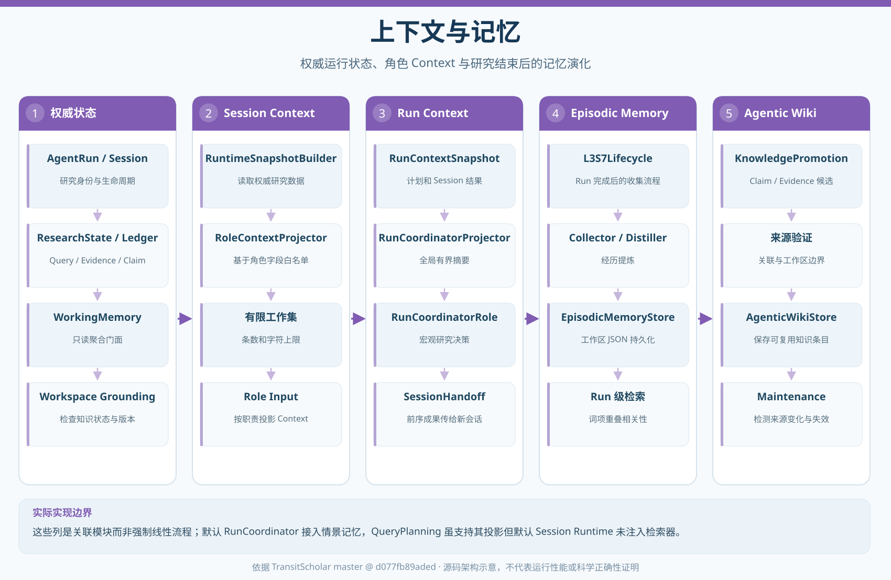

# 上下文与记忆

[返回上级：TransitScholar](../TransitScholar.md) · [返回知识主干](../../main.md)

Context Snapshot、RoleContext Projection、Working Memory、Episodic Memory、Agentic Wiki。本子树按实际实现、设计动机与工程边界组织 Q&A；以下问题均是待核对与待撰写的知识叶子，**尚不构成已验证的答案**。

## 架构图

> 图示边界：这些列是关联模块而非强制线性流程；默认 RunCoordinator 接入情景记忆，QueryPlanning 虽支持其投影但默认 Session Runtime 未注入检索器。
>
> 代码依据（`d077fb89aded`）：[facade.py](https://github.com/XuanzheChen/transit-scholar/blob/d077fb89aded267bc7dc1e5fe33ec6b1e6504c49/src/transit_scholar/layer3/working_memory/facade.py) · [builder.py](https://github.com/XuanzheChen/transit-scholar/blob/d077fb89aded267bc7dc1e5fe33ec6b1e6504c49/src/transit_scholar/layer3/context/builder.py) · [projector.py](https://github.com/XuanzheChen/transit-scholar/blob/d077fb89aded267bc7dc1e5fe33ec6b1e6504c49/src/transit_scholar/layer3/context/projector.py) · [lifecycle.py](https://github.com/XuanzheChen/transit-scholar/blob/d077fb89aded267bc7dc1e5fe33ec6b1e6504c49/src/transit_scholar/layer3/memory/lifecycle.py) · [retrieval.py](https://github.com/XuanzheChen/transit-scholar/blob/d077fb89aded267bc7dc1e5fe33ec6b1e6504c49/src/transit_scholar/layer3/memory/retrieval.py) · [runtime.py](https://github.com/XuanzheChen/transit-scholar/blob/d077fb89aded267bc7dc1e5fe33ec6b1e6504c49/src/transit_scholar/product/runtime.py)。

## 问题目录

- [[TransitScholar/上下文与记忆/上下文与记忆#TransitScholar 如何区分权威 Agent State、Context 与 Working Memory？|TransitScholar 如何区分权威 Agent State、Context 与 Working Memory？]]（待补充）
- [[TransitScholar/上下文与记忆/上下文与记忆#RuntimeContextSnapshotBuilder 如何汇总当前研究状态？|RuntimeContextSnapshotBuilder 如何汇总当前研究状态？]]（待补充）
- [[TransitScholar/上下文与记忆/上下文与记忆#RoleContextProjector 为什么按 Role 裁剪上下文，具体如何限制内容？|RoleContextProjector 为什么按 Role 裁剪上下文，具体如何限制内容？]]（待补充）
- [[TransitScholar/上下文与记忆/上下文与记忆#RunCoordinator 和各 Session Role 的上下文有什么不同？|RunCoordinator 和各 Session Role 的上下文有什么不同？]]（待补充）
- [[TransitScholar/上下文与记忆/上下文与记忆#Episodic Memory 如何形成、保存和检索，当前采用何种排序机制？|Episodic Memory 如何形成、保存和检索，当前采用何种排序机制？]]（待补充）
- [[TransitScholar/上下文与记忆/上下文与记忆#Base Wiki 与 Agentic Wiki 的知识来源和生命周期有什么区别？|Base Wiki 与 Agentic Wiki 的知识来源和生命周期有什么区别？]]（待补充）
- [[TransitScholar/上下文与记忆/上下文与记忆#Knowledge Promotion 如何维护来源与知识有效性？|Knowledge Promotion 如何维护来源与知识有效性？]]（待补充）
- [[TransitScholar/上下文与记忆/上下文与记忆#哪些记忆能力已经在默认生产链路中接入，哪些仍只存在实现接口？|哪些记忆能力已经在默认生产链路中接入，哪些仍只存在实现接口？]]（待补充）

---

## TransitScholar 如何区分权威 Agent State、Context 与 Working Memory？

> 待补充：依据 TransitScholar 实际代码、默认运行链路和必要测试核实后撰写；区分已实现功能、未接入能力及后续设计。

## RuntimeContextSnapshotBuilder 如何汇总当前研究状态？

> 待补充：依据 TransitScholar 实际代码、默认运行链路和必要测试核实后撰写；区分已实现功能、未接入能力及后续设计。

## RoleContextProjector 为什么按 Role 裁剪上下文，具体如何限制内容？

> 待补充：依据 TransitScholar 实际代码、默认运行链路和必要测试核实后撰写；区分已实现功能、未接入能力及后续设计。

## RunCoordinator 和各 Session Role 的上下文有什么不同？

> 待补充：依据 TransitScholar 实际代码、默认运行链路和必要测试核实后撰写；区分已实现功能、未接入能力及后续设计。

## Episodic Memory 如何形成、保存和检索，当前采用何种排序机制？

> 待补充：依据 TransitScholar 实际代码、默认运行链路和必要测试核实后撰写；区分已实现功能、未接入能力及后续设计。

## Base Wiki 与 Agentic Wiki 的知识来源和生命周期有什么区别？

> 待补充：依据 TransitScholar 实际代码、默认运行链路和必要测试核实后撰写；区分已实现功能、未接入能力及后续设计。

## Knowledge Promotion 如何维护来源与知识有效性？

> 待补充：依据 TransitScholar 实际代码、默认运行链路和必要测试核实后撰写；区分已实现功能、未接入能力及后续设计。

## 哪些记忆能力已经在默认生产链路中接入，哪些仍只存在实现接口？

> 待补充：依据 TransitScholar 实际代码、默认运行链路和必要测试核实后撰写；区分已实现功能、未接入能力及后续设计。

**源码核查入口：**[projector.py](https://github.com/XuanzheChen/transit-scholar/blob/master/src/transit_scholar/layer3/context/projector.py) · [lifecycle.py](https://github.com/XuanzheChen/transit-scholar/blob/master/src/transit_scholar/layer3/memory/lifecycle.py) · [retrieval.py](https://github.com/XuanzheChen/transit-scholar/blob/master/src/transit_scholar/layer3/memory/retrieval.py) · [service.py](https://github.com/XuanzheChen/transit-scholar/blob/master/src/transit_scholar/layer3/knowledge_evolution/service.py)。
