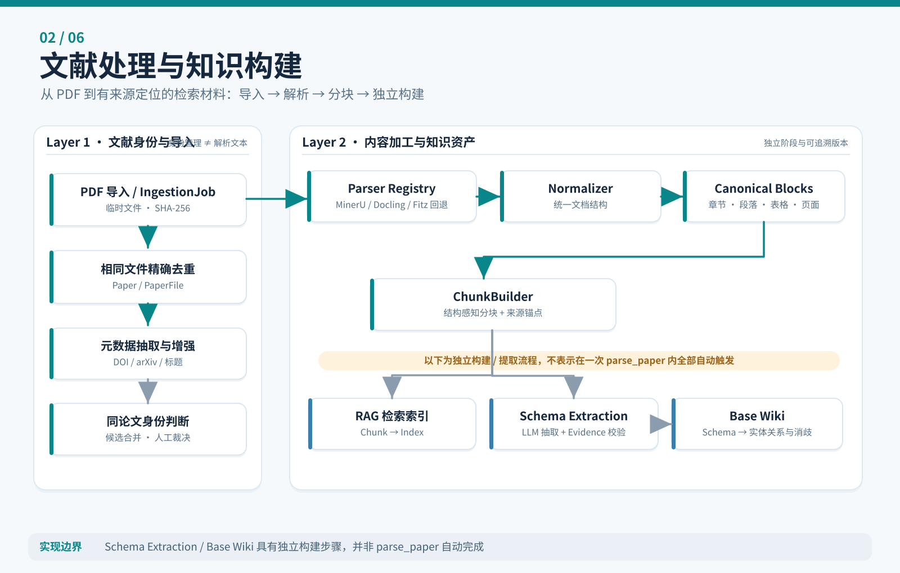

# 文献处理与知识构建

[返回上级：TransitScholar](../TransitScholar.md) · [返回知识主干](../../main.md)

论文身份、PDF 解析、Canonical Blocks、Chunking、Schema 与 Base Wiki 构建。本子树按实际实现、设计动机与工程边界组织 Q&A；以下 Q&A 根据实际代码编写，设计目标与默认已接通的功能分别说明。

## 架构图

> 图示边界：Schema Extraction 和 Base Wiki 不会因为一次 parse_paper 就必然自动完成；它们有独立的构建和验证步骤。
>
> 代码依据（`d077fb89aded`）：[service.py](https://github.com/XuanzheChen/transit-scholar/blob/d077fb89aded267bc7dc1e5fe33ec6b1e6504c49/src/transit_scholar/ingestion/service.py) · [registry.py](https://github.com/XuanzheChen/transit-scholar/blob/d077fb89aded267bc7dc1e5fe33ec6b1e6504c49/src/transit_scholar/layer2/parser/registry.py) · [pipeline.py](https://github.com/XuanzheChen/transit-scholar/blob/d077fb89aded267bc7dc1e5fe33ec6b1e6504c49/src/transit_scholar/layer2/pipeline.py) · [normalizer.py](https://github.com/XuanzheChen/transit-scholar/blob/d077fb89aded267bc7dc1e5fe33ec6b1e6504c49/src/transit_scholar/layer2/normalizer.py) · [chunker.py](https://github.com/XuanzheChen/transit-scholar/blob/d077fb89aded267bc7dc1e5fe33ec6b1e6504c49/src/transit_scholar/layer2/chunker.py) · [api.py](https://github.com/XuanzheChen/transit-scholar/blob/d077fb89aded267bc7dc1e5fe33ec6b1e6504c49/src/transit_scholar/layer2/schema_extraction/api.py) · [application.py](https://github.com/XuanzheChen/transit-scholar/blob/d077fb89aded267bc7dc1e5fe33ec6b1e6504c49/src/transit_scholar/layer2/wiki/application.py)。

## 问题目录

- [[TransitScholar/文献处理与知识构建/文献处理与知识构建#TransitScholar 如何完成论文导入、身份管理、元数据增强与去重？|TransitScholar 如何完成论文导入、身份管理、元数据增强与去重？]]
- [[TransitScholar/文献处理与知识构建/文献处理与知识构建#PDF 解析器如何选择、执行与回退，各解析器的适用边界是什么？|PDF 解析器如何选择、执行与回退，各解析器的适用边界是什么？]]
- [[TransitScholar/文献处理与知识构建/文献处理与知识构建#Normalizer 把不同解析器的 ParserItem 统一为 CanonicalSection、CanonicalBlock？|Normalizer 把不同解析器的 ParserItem 统一为 CanonicalSection、CanonicalBlock？]]
- [[TransitScholar/文献处理与知识构建/文献处理与知识构建#Canonical Blocks 如何保留章节、段落、表格与来源定位？|Canonical Blocks 如何保留章节、段落、表格与来源定位？]]
- [[TransitScholar/文献处理与知识构建/文献处理与知识构建#ChunkBuilder 如何分块，为什么不直接按固定字符数切分论文？|ChunkBuilder 如何分块，为什么不直接按固定字符数切分论文？]]
- [[TransitScholar/文献处理与知识构建/文献处理与知识构建#Schema Extraction 如何提取结构化知识并验证原文依据？|Schema Extraction 如何提取结构化知识并验证原文依据？]]
- [[TransitScholar/文献处理与知识构建/文献处理与知识构建#Base Wiki 如何从论文加工结果构建，和 Schema 有什么区别？|Base Wiki 如何从论文加工结果构建，和 Schema 有什么区别？]]
- [[TransitScholar/文献处理与知识构建/文献处理与知识构建#Wiki 的 Page 和 Entity 是怎么提取的？分别提取了什么内容？以什么文件格式存储？|Wiki 的 Page 和 Entity 是怎么提取的？分别提取了什么内容？以什么文件格式存储？]]
- [[TransitScholar/文献处理与知识构建/文献处理与知识构建#论文解析与知识索引失败时，系统怎样记录与恢复状态？|论文解析与知识索引失败时，系统怎样记录与恢复状态？]]

---

## TransitScholar 如何完成论文导入、身份管理、元数据增强与去重？

`import_paper()` 建立 IngestionJob，将 PDF 复制到临时位置并计算 SHA-256；若文件哈希与已有 PaperFile 相同，就识别为**完全相同的文件**并拒绝重复导入。成功时建立 Paper/PaperFile 记录并迁移文件。后续元数据服务从 PDF、文件名等抽取候选，再保守地选择字段；DOI/arXiv、标题等相似文献通过 `identity` 服务检测和人工裁决，不能把“同文件”与“同论文”画等号。 参见：[导入与精确去重](https://github.com/XuanzheChen/transit-scholar/blob/d077fb89aded267bc7dc1e5fe33ec6b1e6504c49/src/transit_scholar/ingestion/service.py#L25)、[元数据候选](https://github.com/XuanzheChen/transit-scholar/blob/d077fb89aded267bc7dc1e5fe33ec6b1e6504c49/src/transit_scholar/metadata/service.py#L59)、[相似文献判定](https://github.com/XuanzheChen/transit-scholar/blob/d077fb89aded267bc7dc1e5fe33ec6b1e6504c49/src/transit_scholar/identity/service.py#L98)。

## PDF 解析器如何选择、执行与回退，各解析器的适用边界是什么？

`resolve_parsers()` 按可用性排列 Docling → MinerU → PyMuPDF4LLM → PyMuPDF Native（Fitz），也支持指定单个解析器。`parse_paper()` 逐个解析、归一化并验收：首选解析器达标就使用；失败或降级时尝试整篇回退；回退结果仍不满足条件则标记 `needs_review`。解析器选择取决于当前依赖安装与配置，并非所有环境都实际跑四遍。 参见：[解析器选择](https://github.com/XuanzheChen/transit-scholar/blob/d077fb89aded267bc7dc1e5fe33ec6b1e6504c49/src/transit_scholar/layer2/parser/registry.py#L25)、[解析与验收](https://github.com/XuanzheChen/transit-scholar/blob/d077fb89aded267bc7dc1e5fe33ec6b1e6504c49/src/transit_scholar/layer2/pipeline.py#L224)。

## Normalizer 把不同解析器的 ParserItem 统一为 CanonicalSection、CanonicalBlock？

**是的，它负责把不同 PDF 解析器输出的内容变成统一的章节和内容块。** 因为解析器对标题、段落、表格等元素的表示不同，系统需要按阅读顺序整理它们，必要时合并连续段落，并保留内容类型、章节归属、页码和原文位置。

这样后续分块、检索和引用只要理解一种结构，不必分别适配各解析器。**原始解析缺失的页码或位置，系统不会凭空编造。**
## Canonical Blocks 如何保留章节、段落、表格与来源定位？

Normalizer 把不同解析器的 ParserItem 统一为 CanonicalSection、CanonicalBlock，并记录阅读顺序、block 类型、章节关系和来源定位（如页码、字符范围）。后续知识层不必依赖某个 PDF 解析器的私有输出；证据也能从 Chunk 追溯回具体 Block。原解析器没有提供的定位信息不能凭空补齐。 参见：[Normalizer](https://github.com/XuanzheChen/transit-scholar/blob/d077fb89aded267bc7dc1e5fe33ec6b1e6504c49/src/transit_scholar/layer2/normalizer.py#L94)、[Canonical 数据模型](https://github.com/XuanzheChen/transit-scholar/blob/d077fb89aded267bc7dc1e5fe33ec6b1e6504c49/src/transit_scholar/layer2/schema.py)。

## ChunkBuilder 如何分块，为什么不直接按固定字符数切分论文？

ChunkBuilder 先按章节组织 Block，再尽量保留段落、表格及标题的语义边界；太长的单元才拆分，并受目标 Token 与硬上限约束。Chunk 的 `source_refs` 保留 Block ID 和字符范围；表格可按行组切分。相比每 N 字符切一次，这样更容易检索到完整论述并准确引用其原文。 参见：[ChunkBuilder](https://github.com/XuanzheChen/transit-scholar/blob/d077fb89aded267bc7dc1e5fe33ec6b1e6504c49/src/transit_scholar/layer2/chunker.py#L55)。

## Schema Extraction 如何提取结构化知识并验证原文依据？

Schema 是一套字段定义，例如研究方法、实验设置、指标。抽取引擎为每个字段构造查询，从检索结果形成候选证据，再让结构化 LLM 填写字段值、状态和引用；确定性校验会检查类型、Block 是否存在、引用字符范围及摘录是否与 Canonical 文本一致。失败字段会留下明确状态，不是悄悄丢弃；但引用匹配并不等于语义上必然解释正确。 参见：[字段提取](https://github.com/XuanzheChen/transit-scholar/blob/d077fb89aded267bc7dc1e5fe33ec6b1e6504c49/src/transit_scholar/layer2/schema_extraction/engine.py#L332)、[证据完整性](https://github.com/XuanzheChen/transit-scholar/blob/d077fb89aded267bc7dc1e5fe33ec6b1e6504c49/src/transit_scholar/layer2/schema_extraction/evidence_validation.py#L63)。

## Base Wiki 如何从论文加工结果构建，和 Schema 有什么区别？

Base Wiki 以工作区中已绑定的 Schema 定义、各篇论文的 Schema 实例和元数据为输入：先生成字段卡片，再提出实体候选、做实体消歧，建立论文页面与实体关联，最后构建索引并审计状态。**Schema 保存“这篇论文各字段是什么”，Wiki 保存“论文、字段和概念之间怎么连接”。** Wiki 构建是独立步骤，不是每次 PDF 解析都会自动触发。 参见：[工作区 Wiki 构建](https://github.com/XuanzheChen/transit-scholar/blob/d077fb89aded267bc7dc1e5fe33ec6b1e6504c49/src/transit_scholar/layer2/wiki/application.py#L95)、[实体与页面](https://github.com/XuanzheChen/transit-scholar/blob/d077fb89aded267bc7dc1e5fe33ec6b1e6504c49/src/transit_scholar/layer2/wiki/builder.py#L171)。

## Wiki 的 Page 和 Entity 是怎么提取的？分别提取了什么内容？以什么文件格式存储？

**Page 是一篇论文的知识页面，Entity 是论文涉及的研究概念。** Page 根据论文标题、元数据及已经抽取的结构化字段生成摘要和字段概览；Entity 则从这些字段中提出方法、数据集等概念，记录标准名称、别名和解释，再与已有概念比对去重。确认后建立“论文页面—概念”的关联，并保留概念来自哪个字段；有歧义的候选不会强行合并。

数据按工作区保存在 **JSON Lines** 文件中：页面、概念和关联关系分别存储，每行一条记录；另用 **JSON** 文件记录构建版本与状态。

## 论文解析与知识索引失败时，系统怎样记录与恢复状态？

导入使用 IngestionJob 的状态和错误码，必要时对数据库已提交但文件移动失败的情况做对账；解析使用 Manifest 记录源文件哈希、解析器链和规范化版本。只有 `passed/degraded` 的解析结果会提升为当前版本；若只改变 Chunk 或索引配置，可用 `rebuild_derived()` 复用 Canonical 内容。不能把 `needs_review` 的结果当成健康索引。 参见：[导入失败与对账](https://github.com/XuanzheChen/transit-scholar/blob/d077fb89aded267bc7dc1e5fe33ec6b1e6504c49/src/transit_scholar/ingestion/service.py#L194)、[解析版本与派生产物](https://github.com/XuanzheChen/transit-scholar/blob/d077fb89aded267bc7dc1e5fe33ec6b1e6504c49/src/transit_scholar/layer2/pipeline.py#L61)、[rebuild_derived](https://github.com/XuanzheChen/transit-scholar/blob/d077fb89aded267bc7dc1e5fe33ec6b1e6504c49/src/transit_scholar/layer2/pipeline.py#L181)。
