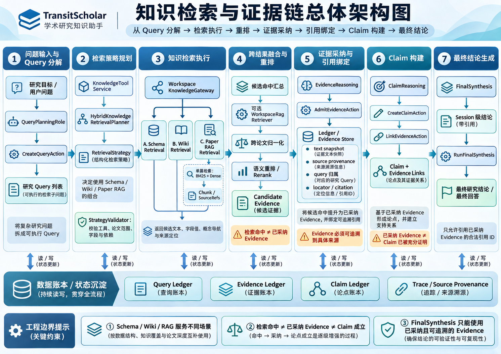

# 知识检索与证据链

[返回上级：TransitScholar](../TransitScholar.md) · [返回知识主干](../../main.md)

Schema、Wiki、RAG 混合检索以及 Query、Evidence、Claim 和来源约束。本子树按实际实现、设计动机与工程边界组织 Q&A；以下 Q&A 根据实际代码编写，设计目标与默认已接通的功能分别说明。

## 架构图

> 图示边界：检索命中 ≠ 已采纳 Evidence ≠ Claim 成立；跨论文 WorkspaceRagRetriever 有实现但默认生产装配未直接接入。
>
> 代码依据（`d077fb89aded`）：[service.py](https://github.com/XuanzheChen/transit-scholar/blob/d077fb89aded267bc7dc1e5fe33ec6b1e6504c49/src/transit_scholar/layer3/tools/service.py) · [service.py](https://github.com/XuanzheChen/transit-scholar/blob/d077fb89aded267bc7dc1e5fe33ec6b1e6504c49/src/transit_scholar/layer3/planner/service.py) · [validation.py](https://github.com/XuanzheChen/transit-scholar/blob/d077fb89aded267bc7dc1e5fe33ec6b1e6504c49/src/transit_scholar/layer3/planner/validation.py) · [gateway.py](https://github.com/XuanzheChen/transit-scholar/blob/d077fb89aded267bc7dc1e5fe33ec6b1e6504c49/src/transit_scholar/layer3/knowledge/gateway.py) · [workspace_rag.py](https://github.com/XuanzheChen/transit-scholar/blob/d077fb89aded267bc7dc1e5fe33ec6b1e6504c49/src/transit_scholar/layer3/retrieval/workspace_rag.py) · [service.py](https://github.com/XuanzheChen/transit-scholar/blob/d077fb89aded267bc7dc1e5fe33ec6b1e6504c49/src/transit_scholar/layer3/ledger/service.py) · [runtime.py](https://github.com/XuanzheChen/transit-scholar/blob/d077fb89aded267bc7dc1e5fe33ec6b1e6504c49/src/transit_scholar/product/runtime.py)。

## 问题目录

- [[TransitScholar/知识检索与证据链/知识检索与证据链#TransitScholar 为什么同时提供 Schema、Wiki 与 RAG 三种知识检索路径？|TransitScholar 为什么同时提供 Schema、Wiki 与 RAG 三种知识检索路径？]]
- [[TransitScholar/知识检索与证据链/知识检索与证据链#HybridKnowledgeRetrievalPlanner 如何提出检索策略，并由代码验证执行？|HybridKnowledgeRetrievalPlanner 如何提出检索策略，并由代码验证执行？]]
- [[TransitScholar/知识检索与证据链/知识检索与证据链#schema和wiki源的检索是怎么做的？|schema和wiki源的检索是怎么做的？]]
- [[TransitScholar/知识检索与证据链/知识检索与证据链#跨论文 RAG 检索如何融合候选与重排序？|跨论文 RAG 检索如何融合候选与重排序？]]
- [[TransitScholar/知识检索与证据链/知识检索与证据链#从单论文 BM25 + Dense 到跨论文重排，完整召回链路如何执行？混合知识检索策略如何二次检索？|从单论文 BM25 + Dense 到跨论文重排，完整召回链路如何执行？混合知识检索策略如何二次检索？]]
- [[TransitScholar/知识检索与证据链/知识检索与证据链#跨论文归一化是怎么做的？|跨论文归一化是怎么做的？]]
- [[TransitScholar/知识检索与证据链/知识检索与证据链#跨论文重排器是如何从多块跨论文候选chunk中排出全局top k的？|跨论文重排器是如何从多块跨论文候选chunk中排出全局top k的？]]
- [[TransitScholar/知识检索与证据链/知识检索与证据链#证据是怎么产生的？|证据是怎么产生的？]]
- [[TransitScholar/知识检索与证据链/知识检索与证据链#检索命中、候选 Evidence 和已采纳 Evidence 有什么区别？|检索命中、候选 Evidence 和已采纳 Evidence 有什么区别？]]
- [[TransitScholar/知识检索与证据链/知识检索与证据链#Claim是怎么生产的？|Claim是怎么生产的？]]
- [[TransitScholar/知识检索与证据链/知识检索与证据链#Claim 与 ClaimEvidenceLink 如何记录论点和论证关系？|Claim 与 ClaimEvidenceLink 如何记录论点和论证关系？]]
- [[TransitScholar/知识检索与证据链/知识检索与证据链#Evidence与Claim如果没有被采纳，会怎么处理？|Evidence与Claim如果没有被采纳，会怎么处理？]]
- [[TransitScholar/知识检索与证据链/知识检索与证据链#最终回答如何检查 Evidence 引用与原文来源，能保证什么、不能保证什么？|最终回答如何检查 Evidence 引用与原文来源，能保证什么、不能保证什么？]]
- [[TransitScholar/知识检索与证据链/知识检索与证据链#Workspace 如何实现知识的隔离？知识版本与引用失效如何影响检索可信性？|Workspace 如何实现知识的隔离？知识版本与引用失效如何影响检索可信性？]]

---

## TransitScholar 为什么同时提供 Schema、Wiki 与 RAG 三种知识检索路径？

三者服务不同场景：Schema 能直接回答某篇论文的结构化字段；Wiki 帮助发现论文、实体和研究概念之间的关联；RAG 回到论文原始文本查找可引用段落。检索规划器可根据 Query 和工作区能力选择或组合这些路径，避免任何问题都靠一次向量 top-k。Schema/Wiki 的导航结果与正式采纳的 Evidence 仍是不同对象。 参见：[三种知识工具](https://github.com/XuanzheChen/transit-scholar/blob/d077fb89aded267bc7dc1e5fe33ec6b1e6504c49/src/transit_scholar/layer3/tools/service.py#L113)、[HybridPlanner](https://github.com/XuanzheChen/transit-scholar/blob/d077fb89aded267bc7dc1e5fe33ec6b1e6504c49/src/transit_scholar/layer3/planner/service.py#L24)。

## HybridKnowledgeRetrievalPlanner 如何提出检索策略，并由代码验证执行？

`HybridKnowledgeRetrievalPlanner` 实际上是一个小agent，外层runtime先把 Query、可用工具、论文范围等写成 Prompt，让 规划器 提出结构化 `RetrievalStrategy`。`validate_strategy()` 再检查 Query ID、动作数量、工具可用性、Schema 字段、论文归属与依赖关系。验证通过才由 KnowledgeToolService 逐个执行；不合法时返回 Diagnostic，**不执行**模型猜出的越权动作。 

## schema和wiki源的检索是怎么做的？

**Schema 和 Wiki 检索的对象不同：Schema 查论文中已经提取好的结构化信息；Wiki 查论文知识页面、研究概念以及历史研究总结。**

- **Schema 检索：** 先筛选当前工作区内已完成结构化提取的论文，再按指定字段读取结果，例如某篇论文采用了什么方法、使用了什么数据集。返回字段值及其原文依据、可信度等信息。**它不是对所有字段做全文搜索，而是按论文和字段定位已有结果。**
- **Wiki 检索：** 在当前工作区的知识页面、概念和可复用研究知识中寻找相关内容。关键词模式通过查询词与标题、摘要或描述的重合程度排序；基础 Wiki 还支持有向量索引时进行语义检索。系统将基础 Wiki 和研究积累的知识分别排序，再合并结果；过期的研究知识默认不参与搜索。

**两者都不能直接代替论文原文证据。** Wiki 可以帮助发现相关论文，再对这些论文执行原文检索；若语义索引不可用，系统会报告降级，而不会把关键词匹配假称为语义检索。

## 跨论文 RAG 检索如何融合候选与重排序？

`WorkspaceRagRetriever` 会枚举当前工作区符合条件的论文，分别调用单篇检索，规范化为跨论文候选，再统一交给语义 Reranker 排序。单篇检索的分数只记录为局部来源信息，**不直接跨论文比较大小**；还检查工作区版本是否在过程中变化。 参见：[跨论文检索](https://github.com/XuanzheChen/transit-scholar/blob/d077fb89aded267bc7dc1e5fe33ec6b1e6504c49/src/transit_scholar/layer3/retrieval/workspace_rag.py#L55)、[默认工厂](https://github.com/XuanzheChen/transit-scholar/blob/d077fb89aded267bc7dc1e5fe33ec6b1e6504c49/src/transit_scholar/product/runtime.py#L125)。

## 从单论文 BM25 + Dense 到跨论文重排，完整召回链路如何执行？混合知识检索策略如何二次检索？

**先区分三种检索链路：单篇论文混合检索、跨论文统一重排、Schema/Wiki/RAG 混合知识检索。三者并不是默认会依次执行的流水线。**

1. **单篇论文的 BM25 + Dense：** PDF 解析为带页码和 原文 参考 的 Chunk，建立关键词索引和可选的向量索引。BM25 召回关键词匹配段落，Dense 召回语义相近段落，再按 Chunk ID 去重，以加权 RRF 融合两路**排名**，取前 Top-K；可调用 Reranker 在这个保护集合内重新排序。
2. **默认 Agent 的多论文检索：** 对每个指定 Paper 搜集证据，每篇结果转为带 Query、Paper、Block、页码和解析版本的 `ResearchEvidence`，合并到 `evidence_results。
3. **可选的跨论文 RAG + 重排：** 系统枚举同一 Workspace 中检索就绪的论文，每篇各召回 k 条，规范化为 `CrossPaperCandidate`，保留单篇 score 作为来源信息，**不把不同论文的局部分数直接比较**。然后调用 `CrossPaperRanker` 排出全局 Top-K；而该 `CrossPaperRanker` 还可组合成“专用模型粗排 → LLM 精排”。

**混合知识检索策略又是怎样的？**

先 `search_schema` 查研究方法、`search_wiki` 发现相关论文； 使用 Wiki 返回的 Paper ID，**再对这些论文执行原文 RAG**。这就是“先发现论文，再检索段落”的**二段召回**。各类结果分别保存在 `schema_results`、`wiki_results`、`evidence_results` 中。若证据仍不足，需要后续 QueryPlanning 再产生新 Query；代码没有写死的“每次重排后自动二次检索”。参见：[策略依赖校验](https://github.com/XuanzheChen/transit-scholar/blob/d077fb89aded267bc7dc1e5fe33ec6b1e6504c49/src/transit_scholar/layer3/planner/validation.py#L20)、[Wiki 发现后的 RAG 派发](https://github.com/XuanzheChen/transit-scholar/blob/d077fb89aded267bc7dc1e5fe33ec6b1e6504c49/src/transit_scholar/layer3/tools/service.py#L259)、[工具结果封装](https://github.com/XuanzheChen/transit-scholar/blob/d077fb89aded267bc7dc1e5fe33ec6b1e6504c49/src/transit_scholar/layer3/tools/contracts.py#L21)。

## 跨论文归一化是怎么做的？

**这里统一的是候选证据的结构，不是把不同论文的分数直接换算为同一种分数。** 系统分别检索每篇论文，取排名靠前的段落，为每条候选补齐统一的文本、论文身份、来源位置、查询归属和唯一编号，并保留单篇检索时的排名与分数作为来源信息。

这样不同论文的候选可以进入同一个重排池，由后续步骤统一比较。**原始分数只在各自论文内部有参考意义，不直接用于跨论文排序。**

## 跨论文重排器是如何从多块跨论文候选chunk中排出全局top k的？

**先汇总多篇论文的候选段落，再根据它们与研究问题的相关性选出前 K 条。** 可选的两阶段方案先用专门的reranker排序模型缩小范围，再让大模型比较：将不同论文的片段交错分组，每组评出先后并淘汰一部分，经过有限轮次留下 K 条；候选足够少时再做一次整体比较。

系统检查排序结果是否引用了不存在或重复的候选；llm精排失败时会fail-close到已有次序，并取top k。

## 证据是怎么产生的？

**证据来自论文原文，而不是模型凭空生成的内容。** 系统先把导入的论文解析为可检索的段落，并保存每段文字来自哪篇论文、哪一页等位置。研究时，Agent 把问题拆成查询，通过检索找到相关原文，得到一批**候选证据**。

接着，Agent 判断哪些候选材料对当前问题有用。只有被选中的材料通过来源和归属检查后，才会作为**正式证据**保存，同时记录原文内容、出处和对应的查询。之后 Agent 可以用这些证据支持某个论点，并在最终回答中引用它们。**检索到的段落不一定会被采纳；被采纳也不代表它一定足以证明论点。**

证据其实就是封装了一层原文内容、出处和对应query的chunk

## 检索命中、候选 Evidence 和已采纳 Evidence 有什么区别？

命中只意味着检索工具返回候选。Candidate Evidence 带论文、位置、Query 等来源信息，暂存在本轮检索观察结果中；EvidenceReasoning 选择需要的 ID 后，`AdmitEvidenceAction` 才会把文本快照和来源写入 Ledger，成为 Accepted Evidence。**检索命中不自动等于可信证据，更不等于论点已成立。** 参见：[证据采纳动作](https://github.com/XuanzheChen/transit-scholar/blob/d077fb89aded267bc7dc1e5fe33ec6b1e6504c49/src/transit_scholar/product/roles.py#L127)、[admit_evidence](https://github.com/XuanzheChen/transit-scholar/blob/d077fb89aded267bc7dc1e5fe33ec6b1e6504c49/src/transit_scholar/layer3/ledger/service.py#L156)。

## Claim是怎么生产的？

**Claim（论点）是 Agent 根据已经采纳的证据提出的研究判断，不是直接从论文里复制的一段话。**

例如，检索到多篇论文关于公交等待控制的实验结果后，Agent 可以提出“这种控制方法有助于减少公交车到站间隔的波动”这一论点，并指出支持它的具体证据。系统随后检查这些证据是否已被正式采纳、是否属于当前研究会话，再保存论点和“哪条证据支持哪项论点”的关联。

因此流程是：**检索原文 → 采纳证据 → 提出论点 → 绑定证据 → 用于最终结论**。系统能保证论点关联的证据真实存在，但不能仅凭这种关联就证明论点一定正确。

## Claim 与 ClaimEvidenceLink 如何记录论点和论证关系？

Claim 是 Agent 提出的可检查论断，含 statement、status 等字段；`ClaimEvidenceLink` 记录哪条已采纳 Evidence 支持该 Claim。ClaimReasoning 先给出结构化 Proposal，ActionPlanner 会拒绝关联未采纳证据，再由 Ledger 校验对象属于当前 Session。这样能追溯“这句话依据哪段文献”，但不自动证明支持关系在科学上充分。 参见：[Claim 动作](https://github.com/XuanzheChen/transit-scholar/blob/d077fb89aded267bc7dc1e5fe33ec6b1e6504c49/src/transit_scholar/product/roles.py#L149)、[Claim 与 Link](https://github.com/XuanzheChen/transit-scholar/blob/d077fb89aded267bc7dc1e5fe33ec6b1e6504c49/src/transit_scholar/layer3/ledger/service.py#L313)。

## Evidence与Claim如果没有被采纳，会怎么处理？

**两者并非同一种“采纳”机制。** 检索到的 Evidence（原文候选）如果没通过筛选，就不会被存为正式证据，也不能作为论点引用的已采纳依据；原始论文段落并未删除，仍可再次检索。

Claim（论点）如果没有被模型提出，就不会创建；已经创建的论点通常先处于“待确认”状态，系统支持将它更新为“有冲突”或“已拒绝”，并保留，直到claim条数接近上限，就会淘汰未被接受的claim，与老旧的claim。

**说明：上述“达到上限后自动淘汰旧论点”属于设想，并非现有实现。** 当前系统会记录和更新论点状态，但没有自动按数量或新旧程度清理 Claim 的机制。

## 最终回答如何检查 Evidence 引用与原文来源，能保证什么、不能保证什么？

Session 的 FinalSynthesis 只使用当前 Session 的持久化 Claim、Accepted Evidence 和关联关系。`FinalSynthesisRole.finalize()` 检查模型引用的 Evidence ID 是否在已采纳列表里，并补入真实 locator、source metadata 和 Claim ID；Run 级汇总还保留 Session 来源。参见：[finalize](https://github.com/XuanzheChen/transit-scholar/blob/d077fb89aded267bc7dc1e5fe33ec6b1e6504c49/src/transit_scholar/layer3/roles/builtin.py#L174)、[Run 汇总](https://github.com/XuanzheChen/transit-scholar/blob/d077fb89aded267bc7dc1e5fe33ec6b1e6504c49/src/transit_scholar/layer3/synthesis/run_final.py#L25)。
本质上是系统运行过程中，会记录evidence的id，并且模型引用的时候，会检验该evidence是否存在，并校验来源是否合法

## Workspace 如何实现知识的隔离？知识版本与引用失效如何影响检索可信性？

Workspace 主要靠**对象归属、论文成员关系、知识版本**来限制检索范围。

1. **归属与成员校验：** `WorkspaceKnowledgeGateway` 固定绑定 `workspace_id`。每次查询前确认 Workspace 仍为 `active`，读取原文或 Schema 前检查 Paper 是否属于当前 Workspace；Wiki 搜索发现的论文 ID 也会与当前成员集求交集。Query 的 Workspace ID 不匹配会被拒绝。
2. **检索期间的版本保护：** 策略规划和每条检索动作前后都会检查工作区版本。如果期间有人调整论文成员或 Workspace 状态，代码抛出 `WorkspaceChangedError`，丢弃不再可靠的部分结果，需重新获取当前知识范围。
3. **原文引用的版本追溯：** Evidence 记录 解析运行id、可信源版本 和来源位置，采纳时还核对 locator 与 provenance 的版本一致性；Agentic Wiki 维护可对来源变化进行失效检查。

