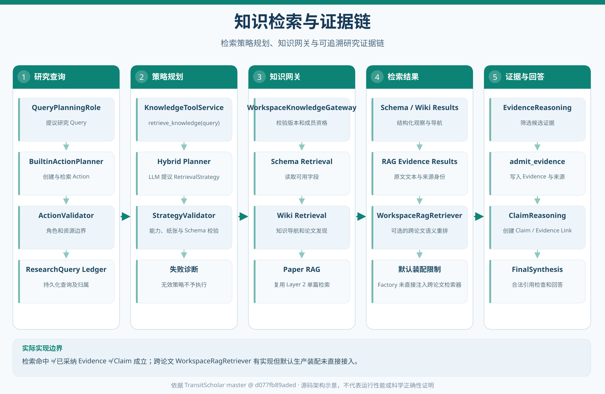

# 知识检索与证据链

[返回上级：TransitScholar](../TransitScholar.md) · [返回知识主干](../../main.md)

Schema、Wiki、RAG 混合检索以及 Query、Evidence、Claim 和来源约束。本子树按实际实现、设计动机与工程边界组织 Q&A；以下 Q&A 根据实际代码编写，设计目标与默认已接通的功能分别说明。

## 架构图

> 图示边界：检索命中 ≠ 已采纳 Evidence ≠ Claim 成立；跨论文 WorkspaceRagRetriever 有实现但默认生产装配未直接接入。
>
> 代码依据（`d077fb89aded`）：[service.py](https://github.com/XuanzheChen/transit-scholar/blob/d077fb89aded267bc7dc1e5fe33ec6b1e6504c49/src/transit_scholar/layer3/tools/service.py) · [service.py](https://github.com/XuanzheChen/transit-scholar/blob/d077fb89aded267bc7dc1e5fe33ec6b1e6504c49/src/transit_scholar/layer3/planner/service.py) · [validation.py](https://github.com/XuanzheChen/transit-scholar/blob/d077fb89aded267bc7dc1e5fe33ec6b1e6504c49/src/transit_scholar/layer3/planner/validation.py) · [gateway.py](https://github.com/XuanzheChen/transit-scholar/blob/d077fb89aded267bc7dc1e5fe33ec6b1e6504c49/src/transit_scholar/layer3/knowledge/gateway.py) · [workspace_rag.py](https://github.com/XuanzheChen/transit-scholar/blob/d077fb89aded267bc7dc1e5fe33ec6b1e6504c49/src/transit_scholar/layer3/retrieval/workspace_rag.py) · [service.py](https://github.com/XuanzheChen/transit-scholar/blob/d077fb89aded267bc7dc1e5fe33ec6b1e6504c49/src/transit_scholar/layer3/ledger/service.py) · [runtime.py](https://github.com/XuanzheChen/transit-scholar/blob/d077fb89aded267bc7dc1e5fe33ec6b1e6504c49/src/transit_scholar/product/runtime.py)。

## 问题目录

- [[TransitScholar/知识检索与证据链/知识检索与证据链#TransitScholar 为什么同时提供 Schema、Wiki 与 RAG 三种知识检索路径？|TransitScholar 为什么同时提供 Schema、Wiki 与 RAG 三种知识检索路径？]]
- [[TransitScholar/知识检索与证据链/知识检索与证据链#HybridKnowledgeRetrievalPlanner 如何提出检索策略，并由代码验证执行？|HybridKnowledgeRetrievalPlanner 如何提出检索策略，并由代码验证执行？]]
- [[TransitScholar/知识检索与证据链/知识检索与证据链#跨论文 RAG 检索如何融合候选与重排序，其默认接入情况如何？|跨论文 RAG 检索如何融合候选与重排序，其默认接入情况如何？]]
- [[TransitScholar/知识检索与证据链/知识检索与证据链#检索命中、候选 Evidence 和已采纳 Evidence 有什么区别？|检索命中、候选 Evidence 和已采纳 Evidence 有什么区别？]]
- [[TransitScholar/知识检索与证据链/知识检索与证据链#Claim 与 ClaimEvidenceLink 如何记录论点和论证关系？|Claim 与 ClaimEvidenceLink 如何记录论点和论证关系？]]
- [[TransitScholar/知识检索与证据链/知识检索与证据链#最终回答如何检查 Evidence 引用与原文来源，能保证什么、不能保证什么？|最终回答如何检查 Evidence 引用与原文来源，能保证什么、不能保证什么？]]
- [[TransitScholar/知识检索与证据链/知识检索与证据链#Workspace 隔离、知识版本与引用失效如何影响检索可信性？|Workspace 隔离、知识版本与引用失效如何影响检索可信性？]]

---

## TransitScholar 为什么同时提供 Schema、Wiki 与 RAG 三种知识检索路径？

三者服务不同场景：Schema 能直接回答某篇论文的结构化字段；Wiki 帮助发现论文、实体和研究概念之间的关联；RAG 回到论文原始文本查找可引用段落。检索规划器可根据 Query 和工作区能力选择或组合这些路径，避免任何问题都靠一次向量 top-k。Schema/Wiki 的导航结果与正式采纳的 Evidence 仍是不同对象。 参见：[三种知识工具](https://github.com/XuanzheChen/transit-scholar/blob/d077fb89aded267bc7dc1e5fe33ec6b1e6504c49/src/transit_scholar/layer3/tools/service.py#L113)、[HybridPlanner](https://github.com/XuanzheChen/transit-scholar/blob/d077fb89aded267bc7dc1e5fe33ec6b1e6504c49/src/transit_scholar/layer3/planner/service.py#L24)。

## HybridKnowledgeRetrievalPlanner 如何提出检索策略，并由代码验证执行？

`HybridKnowledgeRetrievalPlanner` 把 Query、可用工具、论文范围等写成 Prompt，让 LLM 提出结构化 `RetrievalStrategy`。`validate_strategy()` 再检查 Query ID、动作数量、工具可用性、Schema 字段、论文归属与依赖关系。验证通过才由 KnowledgeToolService 逐个执行；不合法时返回 Diagnostic，**不执行**模型猜出的越权动作。 参见：[策略规划](https://github.com/XuanzheChen/transit-scholar/blob/d077fb89aded267bc7dc1e5fe33ec6b1e6504c49/src/transit_scholar/layer3/planner/service.py#L30)、[确定性校验](https://github.com/XuanzheChen/transit-scholar/blob/d077fb89aded267bc7dc1e5fe33ec6b1e6504c49/src/transit_scholar/layer3/planner/validation.py#L20)、[策略执行](https://github.com/XuanzheChen/transit-scholar/blob/d077fb89aded267bc7dc1e5fe33ec6b1e6504c49/src/transit_scholar/layer3/tools/service.py#L259)。

## 跨论文 RAG 检索如何融合候选与重排序，其默认接入情况如何？

`WorkspaceRagRetriever` 会枚举当前工作区符合条件的论文，分别调用 Layer 2 单篇检索，规范化为跨论文候选，再统一交给语义 Reranker 排序。单篇检索的分数只记录为局部来源信息，**不直接跨论文比较大小**；还检查工作区版本是否在过程中变化。默认 `RuntimeFactory` 创建 KnowledgeToolService 时没有直接传入该 Retriever，因此该组件有实现，但不能宣称所有 Run 默认使用了跨论文语义重排。 参见：[跨论文检索](https://github.com/XuanzheChen/transit-scholar/blob/d077fb89aded267bc7dc1e5fe33ec6b1e6504c49/src/transit_scholar/layer3/retrieval/workspace_rag.py#L55)、[默认工厂](https://github.com/XuanzheChen/transit-scholar/blob/d077fb89aded267bc7dc1e5fe33ec6b1e6504c49/src/transit_scholar/product/runtime.py#L125)。

## 检索命中、候选 Evidence 和已采纳 Evidence 有什么区别？

命中只意味着检索工具返回候选。Candidate Evidence 带论文、位置、Query 等来源信息，暂存在本轮检索观察结果中；EvidenceReasoning 选择需要的 ID 后，`AdmitEvidenceAction` 才会把文本快照和来源写入 Ledger，成为 Accepted Evidence。**检索命中不自动等于可信证据，更不等于论点已成立。** 参见：[证据采纳动作](https://github.com/XuanzheChen/transit-scholar/blob/d077fb89aded267bc7dc1e5fe33ec6b1e6504c49/src/transit_scholar/product/roles.py#L127)、[admit_evidence](https://github.com/XuanzheChen/transit-scholar/blob/d077fb89aded267bc7dc1e5fe33ec6b1e6504c49/src/transit_scholar/layer3/ledger/service.py#L156)。

## Claim 与 ClaimEvidenceLink 如何记录论点和论证关系？

Claim 是 Agent 提出的可检查论断，含 statement、status 等字段；`ClaimEvidenceLink` 记录哪条已采纳 Evidence 支持该 Claim。ClaimReasoning 先给出结构化 Proposal，ActionPlanner 会拒绝关联未采纳证据，再由 Ledger 校验对象属于当前 Session。这样能追溯“这句话依据哪段文献”，但不自动证明支持关系在科学上充分。 参见：[Claim 动作](https://github.com/XuanzheChen/transit-scholar/blob/d077fb89aded267bc7dc1e5fe33ec6b1e6504c49/src/transit_scholar/product/roles.py#L149)、[Claim 与 Link](https://github.com/XuanzheChen/transit-scholar/blob/d077fb89aded267bc7dc1e5fe33ec6b1e6504c49/src/transit_scholar/layer3/ledger/service.py#L313)。

## 最终回答如何检查 Evidence 引用与原文来源，能保证什么、不能保证什么？

Session 的 FinalSynthesis 只使用当前 Session 的持久化 Claim、Accepted Evidence 和关联关系。`FinalSynthesisRole.finalize()` 检查模型引用的 Evidence ID 是否在已采纳列表里，并补入真实 locator、source metadata 和 Claim ID；Run 级汇总还保留 Session 来源。**这些检查证明引用对象真实存在、归属正确，不能证明某个因果结论在语义上正确。** 参见：[finalize](https://github.com/XuanzheChen/transit-scholar/blob/d077fb89aded267bc7dc1e5fe33ec6b1e6504c49/src/transit_scholar/layer3/roles/builtin.py#L174)、[Run 汇总](https://github.com/XuanzheChen/transit-scholar/blob/d077fb89aded267bc7dc1e5fe33ec6b1e6504c49/src/transit_scholar/layer3/synthesis/run_final.py#L25)。

## Workspace 隔离、知识版本与引用失效如何影响检索可信性？

WorkspaceKnowledgeGateway 每次访问会验证工作区是否仍有效、论文是否属于该工作区及预期 revision；KnowledgeToolService 也在策略前后重检版本。Evidence 保存 parse_run_id 或 canonical_source_version，让引用知道自己来自哪个解析版本；Knowledge Promotion / Wiki 维护机制可据来源变化标记过期。即便如此，来源版本有效也不代表论文论证本身正确。 参见：[网关边界](https://github.com/XuanzheChen/transit-scholar/blob/d077fb89aded267bc7dc1e5fe33ec6b1e6504c49/src/transit_scholar/layer3/knowledge/gateway.py#L113)、[检索版本校验](https://github.com/XuanzheChen/transit-scholar/blob/d077fb89aded267bc7dc1e5fe33ec6b1e6504c49/src/transit_scholar/layer3/tools/service.py#L81)、[来源身份校验](https://github.com/XuanzheChen/transit-scholar/blob/d077fb89aded267bc7dc1e5fe33ec6b1e6504c49/src/transit_scholar/layer3/ledger/service.py#L235)。
