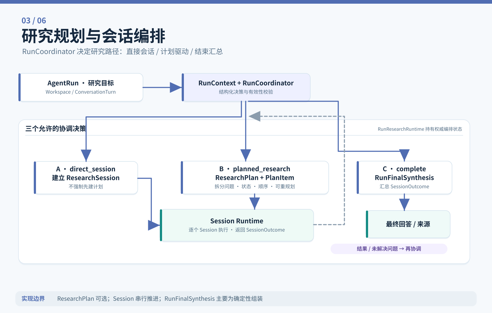

# 研究规划与会话编排

[返回上级：TransitScholar](../TransitScholar.md) · [返回知识主干](../../main.md)

RunCoordinator、ResearchPlan、PlanItem、ResearchSession 和研究结果汇总。本子树按实际实现、设计动机与工程边界组织 Q&A；以下 Q&A 根据实际代码编写，设计目标与默认已接通的功能分别说明。

## 架构图

> 图示边界：ResearchPlan 不是必经步骤；Run 可先执行 direct_session；Run 级最终综合当前是确定性组装。
>
> 代码依据（`d077fb89aded`）：[run_runtime.py](https://github.com/XuanzheChen/transit-scholar/blob/d077fb89aded267bc7dc1e5fe33ec6b1e6504c49/src/transit_scholar/layer3/runtime/run_runtime.py) · [run_coordinator.py](https://github.com/XuanzheChen/transit-scholar/blob/d077fb89aded267bc7dc1e5fe33ec6b1e6504c49/src/transit_scholar/layer3/roles/run_coordinator.py) · [coordination.py](https://github.com/XuanzheChen/transit-scholar/blob/d077fb89aded267bc7dc1e5fe33ec6b1e6504c49/src/transit_scholar/layer3/run_context/coordination.py) · [run_final.py](https://github.com/XuanzheChen/transit-scholar/blob/d077fb89aded267bc7dc1e5fe33ec6b1e6504c49/src/transit_scholar/layer3/synthesis/run_final.py)。

## 问题目录

- [[TransitScholar/研究规划与会话编排/研究规划与会话编排#AgentRun、ResearchPlan、PlanItem 与 ResearchSession 的生命周期如何关联？|AgentRun、ResearchPlan、PlanItem 与 ResearchSession 的生命周期如何关联？]]
- [[TransitScholar/研究规划与会话编排/研究规划与会话编排#RunCoordinator 如何选择直接研究、规划研究或完成 Run？|RunCoordinator 如何选择直接研究、规划研究或完成 Run？]]
- [[TransitScholar/研究规划与会话编排/研究规划与会话编排#RunCoordinator的输出是如何设计的？如何保证其结构化的输出？|RunCoordinator的输出是如何设计的？如何保证其结构化的输出？]]
- [[TransitScholar/研究规划与会话编排/研究规划与会话编排#ResearchPlan 是否为必经步骤，复杂研究如何拆分成多个 Session？|ResearchPlan 是否为必经步骤，复杂研究如何拆分成多个 Session？]]
- [[TransitScholar/研究规划与会话编排/研究规划与会话编排#研究会话之间如何串行执行、交接结果和传递未解决问题？|研究会话之间如何串行执行、交接结果和传递未解决问题？]]
- [[TransitScholar/研究规划与会话编排/研究规划与会话编排#Run 级重规划如何利用前序 SessionOutcome 并防止计划漂移？|Run 级重规划如何利用前序 SessionOutcome 并防止计划漂移？]]
- [[TransitScholar/研究规划与会话编排/研究规划与会话编排#Session FinalSynthesis 与 RunFinalSynthesis 如何分工？|Session FinalSynthesis 与 RunFinalSynthesis 如何分工？]]
- [[TransitScholar/研究规划与会话编排/研究规划与会话编排#RunCoordinator 的计划和决策有哪些确定性校验与上下文限制？|RunCoordinator 的计划和决策有哪些确定性校验与上下文限制？]]
- [[TransitScholar/研究规划与会话编排/研究规划与会话编排#SessionRuntime是什么样的？|SessionRuntime是什么样的？]]

---

## AgentRun、ResearchPlan、PlanItem 与 ResearchSession 的生命周期如何关联？

AgentRun 是一次用户研究任务；ResearchPlan 是可选的任务拆解清单；PlanItem 表示一个待研究的子问题，带顺序、状态和对应 Session ID；ResearchSession 真正执行这个子问题。一个 Run 可以只有一个直接 Session，也可以按计划执行多个 Session，完成后每个 Session 的 Outcome 回到 Run 层。 参见：[计划对象](https://github.com/XuanzheChen/transit-scholar/blob/d077fb89aded267bc7dc1e5fe33ec6b1e6504c49/src/transit_scholar/layer3/planning/models.py#L11)、[Run 调度](https://github.com/XuanzheChen/transit-scholar/blob/d077fb89aded267bc7dc1e5fe33ec6b1e6504c49/src/transit_scholar/layer3/runtime/run_runtime.py#L192)、[Session 持久化](https://github.com/XuanzheChen/transit-scholar/blob/d077fb89aded267bc7dc1e5fe33ec6b1e6504c49/src/transit_scholar/layer3/execution/service.py#L87)。

## RunCoordinator 如何选择直接研究、规划研究或完成 Run？

RunCoordinator 使用有界 `RunCoordinatorContext`，通过结构化语义决策返回 `RunDecision`。`direct_session` 表示只执行一个明确子问题；`planned_research` 表示创建或更新计划；`complete` 表示研究足够，可以汇总。生产装配要求明确的语义决策器，不会因为模型缺失就悄悄切换成简单规则。真正创建 Session、修改计划或终结任务由 RunRuntime 执行。 参见：[RunCoordinator](https://github.com/XuanzheChen/transit-scholar/blob/d077fb89aded267bc7dc1e5fe33ec6b1e6504c49/src/transit_scholar/layer3/roles/run_coordinator.py#L154)、[三种分支](https://github.com/XuanzheChen/transit-scholar/blob/d077fb89aded267bc7dc1e5fe33ec6b1e6504c49/src/transit_scholar/layer3/runtime/run_runtime.py#L175)。
## RunCoordinator的输出是如何设计的？如何保证其结构化的输出？

RunCoordinator 的输出不是自由格式的文字，而是一个 **Pydantic `RunDecision`**：

- `mode`：只允许 `direct_session`（直接研究）、`planned_research`（制定或修改计划）、`complete`（结束 Run）。
- `proposed_questions`：新子问题；`plan_item_updates`：修改已有 PlanItem；`abandon_item_ids`：放弃已有计划项。
- `completion_reason`：结束原因；`metadata`：辅助说明，不能代替真正的动作字段。

结构正确性有**两层保障**。第一层，结构化运行语义决策器 用固定 Prompt 和裁剪后的 运行调度上下文生成结构化的运行决策，并检查字段类型、合法 `mode`、多余字段等；不合格的结构会报错。第二层，runtime会检查**当前状态能否执行这个决定**：例如直接研究必须提出恰好一个问题；已有待执行计划时不能绕过计划；还有运行中或待执行计划项时不能 `complete`；不能更新未知的 PlanItem ID。违反顺序规则会有限次重问，仍不合法则拒绝执行。

**结构化输出只能保证格式与状态转换符合代码约束，不能保证模型的研究判断在语义上正确。**

源码：[RunDecision 定义](https://github.com/XuanzheChen/transit-scholar/blob/d077fb89aded267bc7dc1e5fe33ec6b1e6504c49/src/transit_scholar/layer3/planning/models.py#L11)、[结构化 LLM 调用](https://github.com/XuanzheChen/transit-scholar/blob/d077fb89aded267bc7dc1e5fe33ec6b1e6504c49/src/transit_scholar/layer3/planning/semantic.py#L49)、[协调 Prompt](https://github.com/XuanzheChen/transit-scholar/blob/d077fb89aded267bc7dc1e5fe33ec6b1e6504c49/src/transit_scholar/layer3/prompts/run_coordination.py#L10)、[计划顺序检查](https://github.com/XuanzheChen/transit-scholar/blob/d077fb89aded267bc7dc1e5fe33ec6b1e6504c49/src/transit_scholar/layer3/runtime/run_runtime.py#L361)。

## ResearchPlan 是否为必经步骤，复杂研究如何拆分成多个 Session？

不是。Run 第一次就能返回 `direct_session`，直接进入一个 ResearchSession；只有选择 `planned_research` 才创建 ResearchPlan。计划里的多个 PlanItem 按 `order` 找到下一个 `pending` 子问题，逐个创建和执行 Session。这个项目没有让多个研究 Session 并发协商，因而更容易控制共享状态与来源。 参见：[计划与直接会话](https://github.com/XuanzheChen/transit-scholar/blob/d077fb89aded267bc7dc1e5fe33ec6b1e6504c49/src/transit_scholar/layer3/runtime/run_runtime.py#L192)、[PlanItem 状态](https://github.com/XuanzheChen/transit-scholar/blob/d077fb89aded267bc7dc1e5fe33ec6b1e6504c49/src/transit_scholar/layer3/planning/models.py#L11)。

## 研究会话之间如何串行执行、交接结果和传递未解决问题？

每次 Session 结束后，RunRuntime 将其状态、摘要、Claim/Evidence 引用等封装成 `SessionOutcome`。启动下个 Session 前，`SessionHandoffProjector` 挑选前面已完成会话的摘要、关键 Claim、来源引用和未解问题，按数量与字符预算裁剪后传入。不会把上一个 Session 的完整 LLM 对话和工具日志原封不动复制过去。 

## Run 级重规划如何利用前序 SessionOutcome 并防止计划漂移？

RunRuntime 每次收到 Outcome 后会重新让 Coordinator 决定下一步，可以新增研究问题、更新计划项或放弃某些待办。代码会校验 PlanItem ID、状态与动作模式，阻止直接研究绕过未完成计划、阻止计划未结束时提前 `complete`；不合法决策只有限次重问。**这只能防止状态机级的计划错误，无法自动证明模型提出的研究目标没有语义漂移**，仍依赖模型和用户审查。 

## Session FinalSynthesis 与 RunFinalSynthesis 如何分工？

Session 级 `FinalSynthesisRole` 仍调用 LLM，根据本次 Session 已采纳的 Evidence 和 Claim 生成带引用的局部结论，并验证引用 ID。Run 级 `RunFinalSynthesisRole` 主要由确定性代码拼接多个 `SessionOutcome`、汇总来源和失败信息；只有 RunCoordinator 明确发出 `complete` 后，最终产物才被授权标记为完成。两者不是两个连续自由发挥的生成式 Agent。 

## RunCoordinator 的计划和决策有哪些确定性校验与上下文限制？

第一层用 Pydantic 校验 `RunDecision` 的字段和模式；第二层检查计划顺序：`direct_session` 必须给出一个子问题、不得越过未执行计划，`complete` 不得留下 `pending/running` 的计划项，更新的 ID 必须存在；第三层由 `RunRuntimeConfig` 限制步数、会话数、重规划轮数。输入上下文也有长度预算，超长时会删减详情，因此模型看到的计划摘要可能不完整。这些是工程约束，不是对研究语义正确性的形式化证明。 

## SessionRuntime是什么样的？

**一次研究会话负责一个具体子问题，由同一个 Agent 轮流承担不同职责。** 它先判断下一步做什么，再按需要进行问题拆解、检索论文、筛选证据、建立论点和生成带引用的阶段结论；每个阶段结束后返回协调步骤，由协调步骤决定继续研究还是结束。

模型输出须符合规定格式；真正调用工具或修改数据前还要验证权限。系统保存进度、工具结果和异常，并限制执行步数、调用次数和失败次数，支持中断后的保守恢复。**这些角色是串行切换的，并不是多个 Agent 同时工作。**