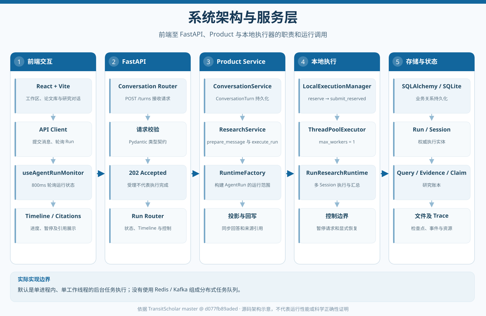

# 系统架构与服务层

[返回上级：TransitScholar](../TransitScholar.md) · [返回知识主干](../../main.md)

前端、FastAPI、Product Service、后台执行管理和数据持久化的调用边界。本子树按实际实现、设计动机与工程边界组织 Q&A；以下 Q&A 根据实际代码编写，设计目标与默认已接通的功能分别说明。

## 架构图

> 图示边界：默认是单进程内、单工作线程的后台任务执行；没有使用 Redis / Kafka 组成分布式任务队列。
>
> 代码依据（`d077fb89aded`）：[conversations.py](https://github.com/XuanzheChen/transit-scholar/blob/d077fb89aded267bc7dc1e5fe33ec6b1e6504c49/src/transit_scholar/api/routers/conversations.py) · [manager.py](https://github.com/XuanzheChen/transit-scholar/blob/d077fb89aded267bc7dc1e5fe33ec6b1e6504c49/src/transit_scholar/api/runtime/manager.py) · [research.py](https://github.com/XuanzheChen/transit-scholar/blob/d077fb89aded267bc7dc1e5fe33ec6b1e6504c49/src/transit_scholar/product/research.py) · [runtime.py](https://github.com/XuanzheChen/transit-scholar/blob/d077fb89aded267bc7dc1e5fe33ec6b1e6504c49/src/transit_scholar/product/runtime.py) · [useAgentRunMonitor.ts](https://github.com/XuanzheChen/transit-scholar/blob/d077fb89aded267bc7dc1e5fe33ec6b1e6504c49/ui/src/features/runs/useAgentRunMonitor.ts)。

## 问题目录

- [[TransitScholar/系统架构与服务层/系统架构与服务层#TransitScholar 的整体分层架构是什么，各层的职责如何划分？|TransitScholar 的整体分层架构是什么，各层的职责如何划分？]]
- [[TransitScholar/系统架构与服务层/系统架构与服务层#前端提交研究问题后，FastAPI 如何创建并启动 AgentRun？|前端提交研究问题后，FastAPI 如何创建并启动 AgentRun？]]
- [[TransitScholar/系统架构与服务层/系统架构与服务层#FastAPI Router、Product Service 与 Agent Runtime 为什么需要分离？|FastAPI Router、Product Service 与 Agent Runtime 为什么需要分离？]]
- [[TransitScholar/系统架构与服务层/系统架构与服务层#LocalExecutionManager 如何调度后台任务，当前并发与扩展边界是什么？|LocalExecutionManager 如何调度后台任务，当前并发与扩展边界是什么？]]
- [[TransitScholar/系统架构与服务层/系统架构与服务层#Workspace、Conversation、ConversationTurn 与 AgentRun 如何关联？|Workspace、Conversation、ConversationTurn 与 AgentRun 如何关联？]]
- [[TransitScholar/系统架构与服务层/系统架构与服务层#系统如何持久化业务对象、文件与运行状态？|系统如何持久化业务对象、文件与运行状态？]]

---

## TransitScholar 的整体分层架构是什么，各层的职责如何划分？

前端用 React、TypeScript 展示论文库、研究对话和运行进度；FastAPI 接收 HTTP 请求并做参数校验；Product Service 管理对话、Run 等业务流程；RuntimeFactory 组装 Agent、知识工具和状态存储；Layer 1/2 处理文献，Layer 3 执行研究。数据库保存业务事实，文件保存解析产物、索引和执行检查点。 参见：[HTTP 入口](https://github.com/XuanzheChen/transit-scholar/blob/d077fb89aded267bc7dc1e5fe33ec6b1e6504c49/src/transit_scholar/api/app.py#L159)、[运行时组装](https://github.com/XuanzheChen/transit-scholar/blob/d077fb89aded267bc7dc1e5fe33ec6b1e6504c49/src/transit_scholar/product/runtime.py#L89)。

## 前端提交研究问题后，FastAPI 如何创建并启动 AgentRun？

`submit_turn()` 先向 `LocalExecutionManager.reserve()` 申请执行资格，再调用 `prepare_message()`：创建用户 Turn、解析本轮目标并创建 AgentRun；之后调用 `submit_reserved()` 把 Run 交给后台线程。HTTP 返回 `202 Accepted` 和两个 ID，而不是等待研究完成。预留失败会返回忙碌错误，创建或派发失败则释放预留并做对应清理。 参见：[submit_turn](https://github.com/XuanzheChen/transit-scholar/blob/d077fb89aded267bc7dc1e5fe33ec6b1e6504c49/src/transit_scholar/api/routers/conversations.py#L127)、[prepare_message](https://github.com/XuanzheChen/transit-scholar/blob/d077fb89aded267bc7dc1e5fe33ec6b1e6504c49/src/transit_scholar/product/research.py#L253)、[reserve](https://github.com/XuanzheChen/transit-scholar/blob/d077fb89aded267bc7dc1e5fe33ec6b1e6504c49/src/transit_scholar/api/runtime/manager.py#L58)。

## FastAPI Router、Product Service 与 Agent Runtime 为什么需要分离？

Router 只负责 HTTP 语义、依赖注入和错误映射；Product Service 负责创建对话、更新 Run 状态等业务规则；Agent Runtime 负责研究规划和执行。这样测试 Agent 时无需启动 Web 服务，替换前端或任务执行方式也不必重写核心研究逻辑。`RuntimeFactory.build_run_scope()` 是三者的主要装配边界。 参见：[RuntimeFactory](https://github.com/XuanzheChen/transit-scholar/blob/d077fb89aded267bc7dc1e5fe33ec6b1e6504c49/src/transit_scholar/product/runtime.py#L56)、[ResearchService](https://github.com/XuanzheChen/transit-scholar/blob/d077fb89aded267bc7dc1e5fe33ec6b1e6504c49/src/transit_scholar/product/research.py#L43)。

## LocalExecutionManager 如何调度后台任务，当前并发与扩展边界是什么？

它使用 `ThreadPoolExecutor(max_workers=1)`，运行时同一进程只允许一个正在执行或已预留的 AgentRun；`reserve()` 在创建 Run 前检查忙碌状态，`submit_reserved()` 再真正派发，避免先写入任务再发现执行槽不可用。工作线程为本次执行创建新的 Product 实例。**这不是** Redis/Kafka 队列，也不具备跨实例统一调度与水平扩展保证。 参见：[LocalExecutionManager](https://github.com/XuanzheChen/transit-scholar/blob/d077fb89aded267bc7dc1e5fe33ec6b1e6504c49/src/transit_scholar/api/runtime/manager.py#L25)。

## Workspace、Conversation、ConversationTurn 与 AgentRun 如何关联？

Workspace 是论文、Schema 和知识访问的隔离边界；一个 Workspace 可以有多个 Conversation；Conversation 按顺序包含 ConversationTurn。用户提交一条 Turn 时，会关联一个 AgentRun；Run 属于 Workspace，并可以进一步创建多个 ResearchSession。对话负责用户可见的往来记录，Run/Session 负责实际研究过程，因此两者不能混为一张表。 参见：[ConversationService](https://github.com/XuanzheChen/transit-scholar/blob/d077fb89aded267bc7dc1e5fe33ec6b1e6504c49/src/transit_scholar/product/conversation.py#L15)、[prepare_message](https://github.com/XuanzheChen/transit-scholar/blob/d077fb89aded267bc7dc1e5fe33ec6b1e6504c49/src/transit_scholar/product/research.py#L253)、[AgentRunService](https://github.com/XuanzheChen/transit-scholar/blob/d077fb89aded267bc7dc1e5fe33ec6b1e6504c49/src/transit_scholar/layer3/execution/service.py#L42)。

## 系统如何持久化业务对象、文件与运行状态？

关系型实体通过 SQLAlchemy 持久化：Workspace、Paper、ConversationTurn、AgentRun、Session、Query、Evidence、Claim 和 Trace 等；默认数据库可使用 SQLite。PDF、Canonical 文档、Chunk、索引、Episodic Memory 以及 Run/Role 检查点存于文件系统。提交 SQL 与发布检查点有顺序控制，但并不构成跨两种存储的原子事务。 参见：[数据库连接](https://github.com/XuanzheChen/transit-scholar/blob/d077fb89aded267bc7dc1e5fe33ec6b1e6504c49/src/transit_scholar/db/engine.py)、[文件状态存储](https://github.com/XuanzheChen/transit-scholar/blob/d077fb89aded267bc7dc1e5fe33ec6b1e6504c49/src/transit_scholar/product/runtime.py#L173)、[Session 状态](https://github.com/XuanzheChen/transit-scholar/blob/d077fb89aded267bc7dc1e5fe33ec6b1e6504c49/src/transit_scholar/layer3/state/service.py#L33)。
