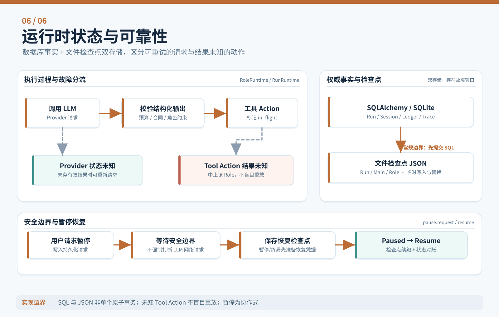

# 运行时状态与可靠性

[返回上级：TransitScholar](../TransitScholar.md) · [返回知识主干](../../main.md)

Research State、Trace、Checkpoint、执行预算、暂停恢复、重试和测试。本子树按实际实现、设计动机与工程边界组织 Q&A；以下问题均是待核对与待撰写的知识叶子，**尚不构成已验证的答案**。

## 架构图

> 图示边界：SQL 与文件检查点不是一个天然事务；未知提交结果的工具动作不自动重放；暂停也不等于立即取消正在进行的 Provider 请求。
>
> 代码依据（`d077fb89aded`）：[role_runtime.py](https://github.com/XuanzheChen/transit-scholar/blob/d077fb89aded267bc7dc1e5fe33ec6b1e6504c49/src/transit_scholar/layer3/runtime/role_runtime.py) · [run_runtime.py](https://github.com/XuanzheChen/transit-scholar/blob/d077fb89aded267bc7dc1e5fe33ec6b1e6504c49/src/transit_scholar/layer3/runtime/run_runtime.py) · [runtime.py](https://github.com/XuanzheChen/transit-scholar/blob/d077fb89aded267bc7dc1e5fe33ec6b1e6504c49/src/transit_scholar/product/runtime.py) · [service.py](https://github.com/XuanzheChen/transit-scholar/blob/d077fb89aded267bc7dc1e5fe33ec6b1e6504c49/src/transit_scholar/layer3/state/service.py) · [service.py](https://github.com/XuanzheChen/transit-scholar/blob/d077fb89aded267bc7dc1e5fe33ec6b1e6504c49/src/transit_scholar/layer3/trace/service.py)。

## 问题目录

- [[TransitScholar/运行时状态与可靠性/运行时状态与可靠性#AgentRun、Session、Role 与 Action 的状态分别由谁持久化？|AgentRun、Session、Role 与 Action 的状态分别由谁持久化？]]（待补充）
- [[TransitScholar/运行时状态与可靠性/运行时状态与可靠性#RunRuntime 与 RoleRuntime 的 Checkpoint 保存了哪些恢复信息？|RunRuntime 与 RoleRuntime 的 Checkpoint 保存了哪些恢复信息？]]（待补充）
- [[TransitScholar/运行时状态与可靠性/运行时状态与可靠性#为什么 LLM 请求中断与 Action 执行中断不能采用相同重试策略？|为什么 LLM 请求中断与 Action 执行中断不能采用相同重试策略？]]（待补充）
- [[TransitScholar/运行时状态与可靠性/运行时状态与可靠性#工具动作已经发出但结果未知时，Runtime 如何避免盲目重复执行？|工具动作已经发出但结果未知时，Runtime 如何避免盲目重复执行？]]（待补充）
- [[TransitScholar/运行时状态与可靠性/运行时状态与可靠性#暂停与恢复如何触发，为什么不是随时强制取消的语义？|暂停与恢复如何触发，为什么不是随时强制取消的语义？]]（待补充）
- [[TransitScholar/运行时状态与可靠性/运行时状态与可靠性#SQL 数据库与文件检查点之间如何控制提交顺序及故障窗口？|SQL 数据库与文件检查点之间如何控制提交顺序及故障窗口？]]（待补充）
- [[TransitScholar/运行时状态与可靠性/运行时状态与可靠性#Agent 的执行步数、LLM 调用和工具调用如何受预算约束？|Agent 的执行步数、LLM 调用和工具调用如何受预算约束？]]（待补充）
- [[TransitScholar/运行时状态与可靠性/运行时状态与可靠性#测试如何覆盖 Agent Runtime 的状态迁移、恢复与故障场景？|测试如何覆盖 Agent Runtime 的状态迁移、恢复与故障场景？]]（待补充）

---

## AgentRun、Session、Role 与 Action 的状态分别由谁持久化？

> 待补充：依据 TransitScholar 实际代码、默认运行链路和必要测试核实后撰写；区分已实现功能、未接入能力及后续设计。

## RunRuntime 与 RoleRuntime 的 Checkpoint 保存了哪些恢复信息？

> 待补充：依据 TransitScholar 实际代码、默认运行链路和必要测试核实后撰写；区分已实现功能、未接入能力及后续设计。

## 为什么 LLM 请求中断与 Action 执行中断不能采用相同重试策略？

> 待补充：依据 TransitScholar 实际代码、默认运行链路和必要测试核实后撰写；区分已实现功能、未接入能力及后续设计。

## 工具动作已经发出但结果未知时，Runtime 如何避免盲目重复执行？

> 待补充：依据 TransitScholar 实际代码、默认运行链路和必要测试核实后撰写；区分已实现功能、未接入能力及后续设计。

## 暂停与恢复如何触发，为什么不是随时强制取消的语义？

> 待补充：依据 TransitScholar 实际代码、默认运行链路和必要测试核实后撰写；区分已实现功能、未接入能力及后续设计。

## SQL 数据库与文件检查点之间如何控制提交顺序及故障窗口？

> 待补充：依据 TransitScholar 实际代码、默认运行链路和必要测试核实后撰写；区分已实现功能、未接入能力及后续设计。

## Agent 的执行步数、LLM 调用和工具调用如何受预算约束？

> 待补充：依据 TransitScholar 实际代码、默认运行链路和必要测试核实后撰写；区分已实现功能、未接入能力及后续设计。

## 测试如何覆盖 Agent Runtime 的状态迁移、恢复与故障场景？

> 待补充：依据 TransitScholar 实际代码、默认运行链路和必要测试核实后撰写；区分已实现功能、未接入能力及后续设计。

**源码核查入口：**[role_runtime.py](https://github.com/XuanzheChen/transit-scholar/blob/master/src/transit_scholar/layer3/runtime/role_runtime.py) · [run_runtime.py](https://github.com/XuanzheChen/transit-scholar/blob/master/src/transit_scholar/layer3/runtime/run_runtime.py) · [service.py](https://github.com/XuanzheChen/transit-scholar/blob/master/src/transit_scholar/layer3/state/service.py) · [service.py](https://github.com/XuanzheChen/transit-scholar/blob/master/src/transit_scholar/layer3/trace/service.py)。
